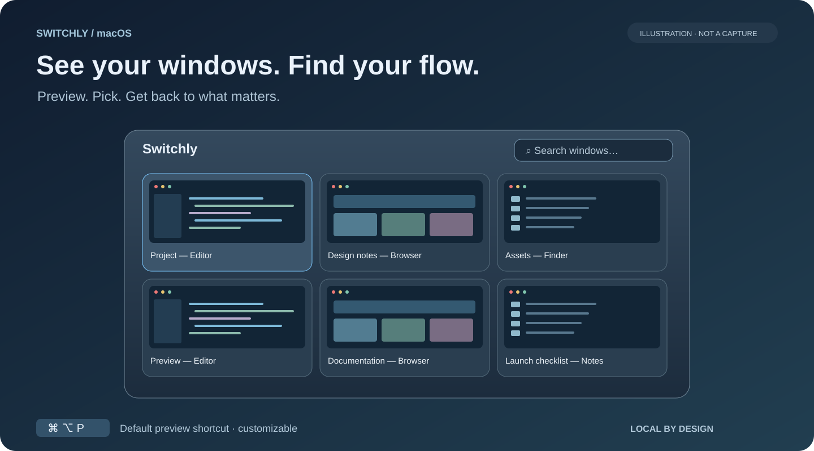
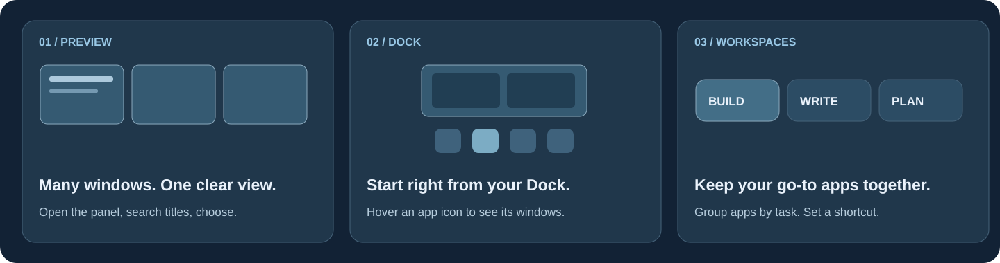

<p align="center">
  
</p>

<h1 align="center">Switchly</h1>
<p align="center"><strong>Your next window, already in sight.</strong><br>A native macOS menu-bar app for visual window preview and switching.</p>

<p align="center">
  <a href="README.md">English</a> · <a href="README.zh-CN.md">简体中文</a>
</p>
<p align="center">
  <a href="https://github.com/leungingit/switchly/releases/latest"><strong>Download for macOS →</strong></a> ·
  <a href="#get-started">Get started</a> ·
  <a href="#build-from-source">Build from source</a>
</p>
<p align="center">
  <a href="https://github.com/leungingit/switchly/releases/latest"></a>
  
  <a href="https://github.com/leungingit/switchly/actions/workflows/ci.yml"></a>
  <a href="LICENSE"></a>
</p>



*Feature illustration with sample content, not a live screenshot. The images describe the current source tree; released versions may differ.*

You know the window you want. It’s the document behind the browser, the other editor window, the reference you opened a moment ago. **Switchly brings window previews into view so you can choose by what you see.** Open the panel, search a title if you need to, and click the window to return to your work.

**Lives in your menu bar. Works on your Mac. No account, no network requests, no uploaded window content.**

## Three ways back to your work



### See the window before you switch

Bring up thumbnails of your open windows with a global shortcut. Search window titles, then select the one you need—even when several belong to the same app. Show every app, or keep the panel focused on the apps you configure.

Want a closer look? Use Window replica mode to preview the highlighted window at its original size and position. Prefer a compact overview? Keep Highlight only mode. Close, minimize, and zoom windows from the preview controls.

### Give your Dock a window view

Hover a Dock icon to see that app’s window thumbnails. Go straight to the document you recognize without opening the full preview panel. Prefer pointer gestures? Enable a screen-edge hotspot or shake-to-open in Preferences.

### Make room for different kinds of work

Group apps into named workspaces—for example, **Build**, **Write**, and **Plan**. Give each workspace a shortcut and choose its window ordering, then access it from a centered workspace bar.

Workspaces organize app groups and access to their windows; they do not create macOS Spaces or save and restore desktop layouts.

## Small details that fit your day

| When you… | Switchly helps you… |
| --- | --- |
| Return to the same apps all day | Assign per-app shortcuts; multiple apps can share a shortcut. |
| Target an app with just one window | Enable auto-switch to go directly to it. |
| Alternate keyboard and mouse | Use shortcuts, Dock hover, or optional pointer triggers. |
| Prefer a quieter desktop | Keep Switchly in the menu bar, with no Dock icon; optionally launch at login. |
| Want the panel to feel like yours | Choose light, dark, or system appearance; independently choose a light or dark glass backing, pick any crystal tint colour, or turn glass off. |
| Want to understand your usage | View local keyboard/mouse counts and estimated time savings; clear them at any time. Estimates are not measured productivity gains. |

English and Simplified Chinese are built in. Animations respect the system **Reduce Motion** setting.

<details>
<summary><strong>A look at the native preferences</strong></summary>


*Rendered from native SwiftUI source during the appearance review, rather than captured from a live desktop. This image shows layout and controls; it does not demonstrate live backdrop blur or the complete set of settings.*

</details>

## Get started

**Requires macOS 12 or later.** Release packaging targets Apple Silicon and Intel with a universal app; only Apple Silicon has been tested. You do not need Xcode to use a downloaded app.

1. **[Open Releases](https://github.com/leungingit/switchly/releases/latest)** and download `Switchly-<version>.zip`. Unzip it and move `Switchly.app` to **Applications**.
2. **Open Switchly** and grant **Accessibility** to let it find and focus windows. Grant **Screen Recording** to show window thumbnails. These permissions live in **System Settings → Privacy & Security**; older macOS versions use System Preferences.
3. **Set up your first preview.** In Switchly’s menu-bar Preferences, open **General → Window source** and choose **Preview All Windows**. The default is **Only Configured Apps**, so you can instead add apps in the **Apps** tab.
4. **Press `⌘ ⌥ P`**, the default preview shortcut. Find a window and click it. Change the shortcut in Preferences if it conflicts with another app.

**Try it with two windows from the same app.** That is where choosing by preview becomes especially useful.

### First-launch questions

<details>
<summary><strong>macOS warns when opening the app</strong></summary>

Unless a release explicitly says otherwise, builds are ad-hoc signed and not notarized. Check that you downloaded from this repository’s Releases page, read that release’s signing notes, then use the macOS **Open** / **Open Anyway** flow if you trust the download. Availability and wording vary by macOS version.

To verify archive integrity, download the matching `.sha256` file into the same directory and run the following, replacing `<version>` with the downloaded version:

```sh
shasum -a 256 -c Switchly-<version>.zip.sha256
```

A checksum checks file integrity; it does not replace macOS signature verification.

</details>

<details>
<summary><strong>The preview panel is empty</strong></summary>

Open some app windows. Then choose **General → Window source → Preview All Windows**, or add running apps in **Apps**. Verify that Accessibility is granted to the copy of Switchly you are actually running.

</details>

<details>
<summary><strong>I see app icons and titles, but no window images</strong></summary>

Enable Screen Recording for Switchly. On recent macOS versions this permission is called **Screen & System Audio Recording**; Switchly does not record audio. Without it, icons and titles remain available and window switching still works when Accessibility is granted.

</details>

## Your windows stay on your Mac

Window contents are personal. Switchly processes them locally, with no account, online license check, telemetry SDK, or network requests.

- **Thumbnails:** compressed small previews can be cached locally for up to **24 hours from capture**, within a **64 MB** disk budget. Full-size enlarged previews are not saved to disk.
- **Cache identity:** reuse requires the same system boot session, target app process, and matching window identity. Restarting Switchly can reuse eligible thumbnails; restarting the target app or your Mac cannot.
- **Control:** delete `~/Library/Caches/Switchly/Thumbnails/` to clear disk previews. Expired files are rejected on read; cleanup also runs at launch and on writes. Files that expire while Switchly is closed are cleaned at the next launch.
- **Usage statistics:** local counts and estimated savings, with a clear action in the app. Nothing is uploaded.

Cached images can contain window content and are not additionally encrypted. See the [privacy policy](PRIVACY_POLICY.md) and [thumbnail cache details](docs/thumbnail-cache.md) for storage and retention behavior.

Design and interface work follows the [design system](docs/design-system.md) and [UI engineering guidelines](docs/ui-guidelines.md).

## Build from source

Use **Xcode 26+**, Swift 5.9, and [XcodeGen](https://github.com/yonaskolb/XcodeGen). `project.yml` defines the project configuration and macOS 12 deployment target. Glass styling currently uses shared AppKit/SwiftUI materials; it does not claim a native macOS `View.glassEffect` implementation.

```sh
git clone https://github.com/leungingit/switchly.git
cd switchly
brew install xcodegen
make bootstrap
make build
make test-unit
make run
```

`make run` quits an existing Switchly instance before launching the Debug build. The app is built at `DerivedData/Build/Products/Debug/Switchly.app`. Run `make help` for all targets. `make dist` or `./build.sh` prepares a distribution copy in `build/`.

<details>
<summary><strong>Signing and stable development permissions</strong></summary>

A fresh clone uses ad-hoc signing (`CODE_SIGN_IDENTITY = -`) without an Apple Developer account. Signing precedence is:

1. Explicit `make build SIGN_IDENTITY="…"` override.
2. Your git-ignored `Config/Local.xcconfig`.
3. `Config/Base.xcconfig` defaults.

Ad-hoc rebuilds can cause macOS to request permissions again. For a stable local identity, run `Scripts/create-dev-cert.sh` and configure `Config/Local.xcconfig` from the example. See [CONTRIBUTING.md](CONTRIBUTING.md) for the complete setup.

```sh
make build SIGN_IDENTITY="Apple Development: Your Name (TEAMID)"
make dist SIGN_IDENTITY="Developer ID Application: Your Name (TEAMID)"
```

Release automation uses Developer ID signing and notarization when the required secrets are configured, and ad-hoc signing otherwise. See [the release guide](docs/RELEASING.md).

</details>

## Help shape Switchly

Found a window that will not focus, or have an idea for a smoother workflow? [Open an issue](https://github.com/leungingit/switchly/issues) with your macOS version, chip, affected app, and reproduction steps. Please follow [SECURITY.md](SECURITY.md) for private security reports.

Contributors can start with [CONTRIBUTING.md](CONTRIBUTING.md), the [Code of Conduct](CODE_OF_CONDUCT.md), and the MVVM directories: `App/`, `Models/`, `ViewModels/`, `Views/`, `Services/`, and `Utilities/`. Before publishing, `./verify.sh` checks toolchain, versions, tracked artifacts, and privacy hygiene. Release procedures live in [docs/RELEASING.md](docs/RELEASING.md); changes live in [CHANGELOG.md](CHANGELOG.md).

[MIT licensed](LICENSE).

---

**Less looking for windows. More time in the right one.**

[Download Switchly for macOS →](https://github.com/leungingit/switchly/releases/latest)
