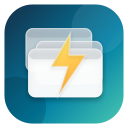
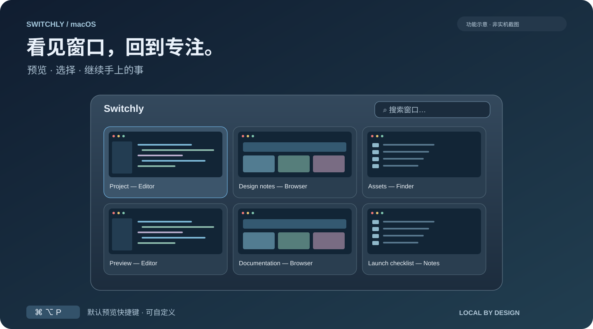
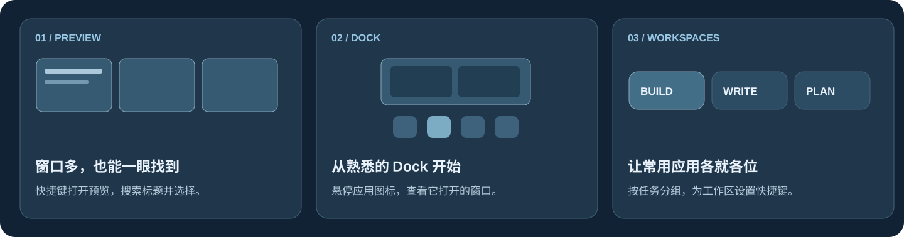
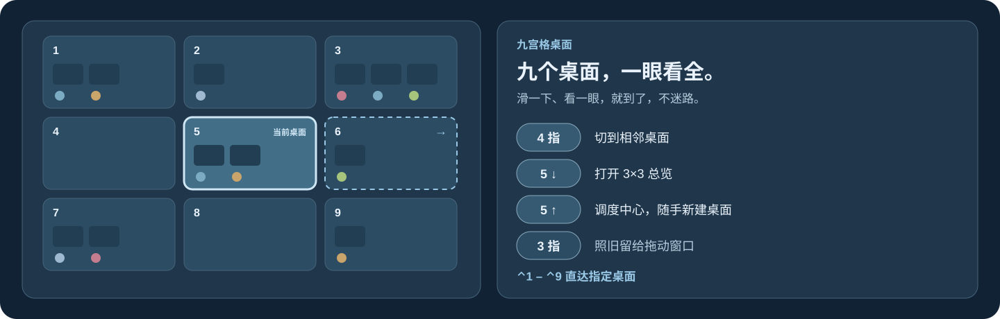
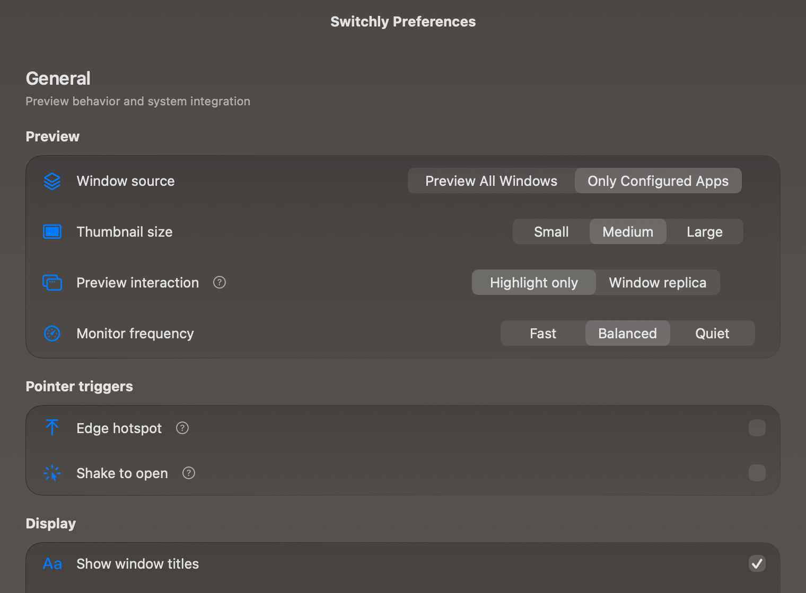

<p align="center">
  
</p>

<h1 align="center">Switchly</h1>
<p align="center"><strong>想回到的窗口，一眼就找到。</strong><br>原生 macOS 菜单栏工具，让窗口预览与切换更直觉。</p>

<p align="center">
  <a href="README.md">English</a> · <a href="README.zh-CN.md">简体中文</a>
</p>
<p align="center">
  <a href="https://github.com/leungingit/switchly/releases/latest"><strong>下载 macOS 版 →</strong></a> ·
  <a href="#开始体验">开始体验</a> ·
  <a href="#从源码构建">从源码构建</a>
</p>
<p align="center">
  <a href="https://github.com/leungingit/switchly/releases/latest"></a>
  
  <a href="https://github.com/leungingit/switchly/actions/workflows/ci.yml"></a>
  <a href="LICENSE"></a>
</p>



*上图为使用示例内容绘制的功能示意，非实机截图。本文介绍当前源码中的能力，已发布版本可能有所不同。*

你记得要找的窗口：浏览器后面的文档、同一个编辑器里的另一个项目、刚刚打开的参考资料。**Switchly 把窗口预览带到眼前，让你凭内容找到它。** 唤出面板，需要时搜索标题，点击目标窗口，就能接着做刚才的事。

**常驻菜单栏，完全本地运行。无需账户，没有网络请求，窗口内容不上传。**

全局预览新增「全部桌面／当前桌面」范围，默认全部桌面；应用专属预览与 Dock 预览保持全量。其他桌面、最小化和隐藏状态分别标记，无法截图时保留图标与标题。跨桌面实现仍待实机验收，验证边界见 [验证记录](docs/reviews/all-spaces-window-preview.md)。

## 三种方式，回到手上的事



### 切换之前，先看见窗口

用全局快捷键展开窗口缩略图，搜索标题，再选择你要的那个窗口。同一应用打开了多个窗口，也能按内容辨认。你可以预览所有应用，也可以只保留自己配置的常用应用。

想看得更清楚？切换到「窗口副本」，按原始大小和位置预览选中的窗口；偏爱紧凑总览，则保留「仅高亮」模式。关闭、最小化、缩放窗口，也可以从预览控件完成。

### 让熟悉的 Dock，多一层预览

鼠标悬停 Dock 应用图标，查看这个应用打开的窗口，直接选中认得的那一张，无需先打开完整预览面板。偏爱鼠标操作？还可以在偏好设置中开启屏幕边缘热点，或摇动指针唤出面板。

悬停 Apple Music 时还会出现播放 / 暂停、上一首、下一首和喜欢按钮，即使 Music 窗口已关闭也可使用。首次使用时 macOS 会询问是否允许 Switchly 控制「音乐」（自动化权限）。

### 不同任务，有各自的工作区

把应用分成「开发」「写作」「计划」等命名工作区，为每组配置快捷键和窗口排序，再从居中的工作区栏进入。

工作区用于组织应用分组与窗口入口，不会创建 macOS 空间，也不负责保存和恢复桌面窗口布局。

## 九宫格桌面：所有桌面，一眼看全



*示意图使用虚构内容，非产品实拍截图。*

桌面开到五六个，就记不清表格在哪一个上了。九宫格把 macOS 的桌面排成一张 3×3 地图，每格显示编号、窗口和所属应用，用手指就能在里面走来走去。

- **滑一下就到，八个方向都行。** 四指滑动前往相邻桌面，左右上下，连斜向都可以。滑动时有小巧的 HUD 告诉你要去哪；方向默认和 macOS 一样跟随手指，也可以反过来。
- **五指下滑，全局一览。** 打开总览，所有桌面同时摆在眼前，点一下、用方向键或按 `Return` 即可前往。`⌃1`–`⌃9` 在任何地方都能直达指定桌面。
- **触控板照旧顺手。** 九宫格开启时，四指滑动由 Switchly 接手，不会出现系统和九宫格同时动的情况，也不用去系统设置里关这关那。五指上滑打开调度中心，方便新建桌面；三指拖动窗口完全不受影响。
- **一分钟完成设置。** 偏好设置的「九宫格」标签页会检查 macOS 需要的条件：辅助功能、屏幕录制、至少两个桌面、系统「切换到桌面」快捷键。缺哪项，点一下就打开对应的系统设置面板，另有设置引导窗口按同一份清单逐步说明。

在「偏好设置 → 九宫格」中开启（默认关闭）。九宫格只使用 macOS 已有的桌面，不会创建、删除或重排。接管四指手势依赖 macOS 未公开的行为；如果将来的系统版本有变化，关闭「接管系统四指手势」，系统手势会立即恢复。

## 日常用起来，顺手的细节

| 当你…… | Switchly 可以…… |
| --- | --- |
| 一天反复打开几个常用应用 | 设置应用专属快捷键，也支持多个应用共用一个快捷键。 |
| 目标应用只有一个窗口 | 开启自动切换，直接进入目标窗口。 |
| 在键盘和鼠标之间切换 | 使用快捷键、Dock 悬停，或按需开启指针触发。 |
| 希望桌面少一点打扰 | 只保留菜单栏图标，不占 Dock；可选登录时启动。 |
| 想让面板更合自己的习惯 | 选择浅色、深色或跟随系统；在「外观」页选择透明或磨砂玻璃，统一调整密度与染色，也可以关闭玻璃。macOS 26+ 可点「清除玻璃叠层」，回到所选材质的原生效果。设置组在各材质下都保留细边框；「窗口卡片」组可单独设置预览网格、Dock 预览与工作区栏的卡片底色，高级项可调卡片分隔与白色反光，并提供缩略图衬底即时样例。 |
| 想了解自己的使用习惯 | 查看本地键盘与鼠标使用次数、估算节省时间，并随时清除。估算不代表实测效率收益。 |

内置**英文与简体中文**。动画遵循系统的「减少动态效果」设置。

<details>
<summary><strong>看看原生偏好设置</strong></summary>



*此图来自外观评审时对原生 SwiftUI 源码的渲染，非桌面实拍。用于展示布局与控件，不代表真实壁纸透射效果，也未展示全部设置。*

</details>

## 开始体验

**需要 macOS 12 或更新版本。** 发布打包面向 Apple Silicon 与 Intel，使用 Universal 应用；目前仅在 Apple Silicon 上测试。下载使用无需安装 Xcode。

1. **[前往 Releases](https://github.com/leungingit/switchly/releases/latest)**，下载 `Switchly-<version>.zip`，解压后把 `Switchly.app` 拖进「应用程序」。
2. **打开 Switchly 并授权**：「辅助功能」用于查找和聚焦窗口；「屏幕录制」用于显示窗口缩略图。权限位于「系统设置 → 隐私与安全性」，旧版 macOS 对应「系统偏好设置」。
3. **配置第一次预览**：从菜单栏进入 Switchly 偏好设置，在「通用 → 窗口来源」选择「预览所有窗口」。默认是「仅配置的应用」，你也可以到「应用」页先添加常用应用。
4. **按下默认快捷键 `⌘ ⌥ P`**，找到窗口并点击进入。如果与其他应用冲突，可以在偏好设置中修改快捷键。

**建议先用同一个应用的两个窗口试一试。** 看图选窗口的价值，在这里最容易感受到。

### 首次使用常见问题

<details>
<summary><strong>macOS 提示无法直接打开应用</strong></summary>

除非该版本发布说明另有声明，发布包使用临时签名，尚未经过 Apple 公证。请确认文件来自本仓库 Releases，查看对应版本的签名说明；信任下载来源后，可通过 macOS 的「打开」或「仍要打开」流程启动。入口与文案随 macOS 版本有所不同。

若要校验文件完整性，请把对应 `.sha256` 文件一起下载到同一目录，将下面的 `<version>` 替换为实际版本后执行：

```sh
shasum -a 256 -c Switchly-<version>.zip.sha256
```

校验和用于检查文件完整性，不能替代 macOS 签名验证。

</details>

<details>
<summary><strong>预览面板没有窗口</strong></summary>

先打开一些应用窗口，再选择「通用 → 窗口来源 → 预览所有窗口」，或在「应用」页添加正在运行的应用。确认授予辅助功能权限的，是你当前实际运行的那份 Switchly。

</details>

<details>
<summary><strong>只能看到图标和标题，看不到窗口图片</strong></summary>

请为 Switchly 开启「屏幕录制」权限。较新 macOS 可能称其为「屏幕与系统音频录制」；Switchly 不录制音频。未授权时会降级显示应用图标和窗口标题，辅助功能权限正常时仍可切换窗口。

</details>

## 你的窗口，留在你的 Mac

窗口里装着你的工作内容。Switchly 在本机处理它们，不需要账户、在线授权检查、遥测 SDK 或网络请求。

- **缩略图**：压缩小图可在本地缓存，自原始截图时间起最多复用 **24 小时**，磁盘预算 **64 MB**。放大预览原图不保存到磁盘。
- **身份校验**：只有同一系统启动会话、同一目标应用进程且窗口身份匹配才可复用。重启 Switchly 可以复用符合条件的小图；重启目标应用或 Mac 后不复用此前图片。
- **自行控制**：可删除 `~/Library/Caches/Switchly/Thumbnails/` 清空磁盘预览。读取时拒绝过期图片，启动与写入时也会清理；Switchly 关闭期间过期的文件在下次启动清理。
- **使用统计**：次数与节省时间估算仅保存在本机，可在应用中清除，不上传。

缓存图片可能包含窗口内容，未进行额外加密。完整存储与保留规则见[隐私政策](PRIVACY_POLICY.md)和[缩略图缓存说明](docs/thumbnail-cache.md)。

设计与界面开发遵循[设计系统](docs/design-system.md)和[界面工程约束](docs/ui-guidelines.md)。

## 从源码构建

使用 **Xcode 26+**、Swift 5.9 和 [XcodeGen](https://github.com/yonaskolb/XcodeGen)。工程配置以 `project.yml` 为准，最低运行系统为 macOS 12。透明玻璃在 macOS 26+ 使用 AppKit 原生 `NSGlassEffectView`，旧系统降级为普通系统材质；也可选择磨砂或实色外观。

```sh
git clone https://github.com/leungingit/switchly.git
cd switchly
brew install xcodegen
make bootstrap
make build
make test-unit
make run
```

`make run` 会退出已有 Switchly 实例，再启动 Debug 版本。产物位于 `DerivedData/Build/Products/Debug/Switchly.app`。全部命令见 `make help`；`make dist` 或 `./build.sh` 会在 `build/` 准备分发副本。

<details>
<summary><strong>签名与开发期间的稳定权限</strong></summary>

全新克隆默认使用临时签名（`CODE_SIGN_IDENTITY = -`），无需 Apple 开发者账户。签名配置优先级从高到低为：

1. 显式传入 `make build SIGN_IDENTITY="…"`。
2. 被 git 忽略的本地 `Config/Local.xcconfig`。
3. `Config/Base.xcconfig` 默认值。

临时签名重建后，macOS 可能要求重新授权。开发时可执行 `Scripts/create-dev-cert.sh`，并参照示例配置 `Config/Local.xcconfig`，使用稳定的本地签名身份。完整步骤见 [CONTRIBUTING.md](CONTRIBUTING.md)。

```sh
make build SIGN_IDENTITY="Apple Development: Your Name (TEAMID)"
make dist SIGN_IDENTITY="Developer ID Application: Your Name (TEAMID)"
```

发布自动化在必需 secrets 配置完整时使用 Developer ID 签名与公证，否则采用临时签名。详见[发布指南](docs/RELEASING.md)。

</details>

## 一起把 Switchly 做得更顺手

遇到无法聚焦的窗口，或想到更顺畅的操作方式？欢迎[提交 Issue](https://github.com/leungingit/switchly/issues)，附上 macOS 版本、芯片、受影响应用与复现步骤。安全问题请按 [SECURITY.md](SECURITY.md) 私下报告。

参与开发可先阅读 [CONTRIBUTING.md](CONTRIBUTING.md)、[行为准则](CODE_OF_CONDUCT.md)，以及 MVVM 目录 `App/`、`Models/`、`ViewModels/`、`Views/`、`Services/` 和 `Utilities/`。发布前执行 `./verify.sh` 检查工具链、版本、跟踪产物与隐私卫生。发布步骤见 [docs/RELEASING.md](docs/RELEASING.md)，历史变更见 [CHANGELOG.md](CHANGELOG.md)。

采用 [MIT 开源协议](LICENSE)。

---

**少一点找窗口，多一点做事情。**

[下载 Switchly macOS 版 →](https://github.com/leungingit/switchly/releases/latest)
