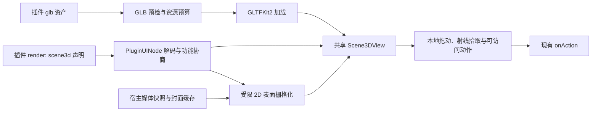

# 插件 `scene3d` 实施方案：以音乐 iPod 为验收目标

> 日期：2026-11-06。状态：**实施设计与合同冻结（D26）；G0 未通过，宿主尚未实现**。选型依据为 [C-D01 与 C-V01～C-V07](plugin-3d-rendering-options-2026-11-06.md)。子任务见 [任务书](plugin-scene3d-tasks.md)。T00 已把正式值同步至设计台账、`Plugins/api/` 与 SDK，并同步预览合同哈希；宿主 `scene3d` 解码与渲染仍待 T04～T07，不能把本文当作现行可渲染能力。

## 1. 目标、边界与事实

**最终验收**：相邻 `switchly-plugins` 仓库的 `com.switchly.music-controls` 以真实媒体快照在 Switchly Dock 插件 `center` 槽位显示可鼠标旋转的写实 iPod：封闭薄机身、白色正面、随视角变化的金属侧边和背板、正常的歌曲屏幕、可点击转盘；连续旋转时无屏幕撕裂。插件作者独立交付模型和表面内容；宿主不得含 iPod ID、iPod 造型或音乐按钮布局分支。第二种圆形气压计样本必须通过同一节点、校验器和渲染器。

现行音乐插件 `apiVersion: 1`，默认普通卡片，`wheelLayout` 是可选 2D 布局；其 `render()` 使用 `ctx.media.nowPlaying()`，`onAction` 处理 `toggle`、`previous`、`next`、`love`。现行宿主 `PluginUINode` 只有 2D `scene`；`PluginOverlayView` 经 `PluginSlotSurface` 为正式 Dock 与独立预览共用。现行 `ctx.capabilities` 表示**授权后的权限**，不能改作 UI 功能表。`PluginPackageValidator` 的 32 MiB 包限额无法约束 glb 内部 URI 或解码后资源。现行预览契约要求共用宿主真实解码器和渲染代码。

本期只增加宿主受控 3D 能力，不引入 WKWebView、插件逐帧 JS、运行时网络、插件任意着色器或按设备类型分支；二维 `scene` 语义保持不变。相机、命名表面、命中与材质边界是通用合同。Swift 改动与插件外仓改动按各自仓库分别验证。

## 2. 公开合同候选

### 2.1 版本与后备

`scene3d` 作为 `apiVersion: 2` 的**协商式增量能力**：新宿主在 `ctx.uiFeatures.scene3d === true` 时允许该节点；已支持 v2、但没有 `uiFeatures` 的宿主收到更新后的插件时，插件返回原有 2D 节点。`uiFeatures` 由宿主给出，与 `ctx.capabilities` 权限表分离；预览必须给相同值。不得仅靠 `apiVersion: 2` 推断可渲染 3D。若旧宿主收到 `scene3d`，仍按未知节点拒绝，不静默显示空白。已发布 v1.3.0 宿主只接受 v1，会在加载阶段拒绝迁移后的 v2 插件包，JS 回退无法补救。D26/T00 已冻结同一插件 ID 的双发行线：v1 线供旧宿主，v2 线供新宿主，任一宿主锁文件只能锁一条线，新宿主只加载 v2；外仓目录、分支与 revision 由 T09 落地。旧宿主实机行为仍未验证，不能称其兼容。`wheelLayout` 与普通卡片保留，新增 `ipod3d` 设置默认关闭；设置开启但环境不支持时显示现有 2D 点按转盘。旧宿主实机未验，兼容结论只来自当前宿主行为与加载器代码。正反契约样本已写入 `Tests/Fixtures/Scene3D/`。

新宿主遇到槽位实际尺寸不足时，使用 `scene3d.fallback` 的 2D 节点。D26 已将最小可读尺寸 **220×380 pt** 冻结为候选值，依据实际 120 pt 默认卡片无法清楚读出原型歌曲屏幕；真实 Dock 布局截图仍未测，故 G0 未通过。宽度与高度由宿主布局测量，插件 JS 不轮询窗口尺寸。`fallback` 和 3D 命中可以复用同一业务 action ID，因为两条展示分支不会同时生效；不同可见槽位之间仍须唯一。不得为了 iPod 单独改变全局 Dock 宽度。

### 2.2 节点示意

```js
{
  type: "scene3d", key: "music-player", asset: "assets/ipod.glb",
  fit: "contain", camera: { yaw: -20, pitch: -8 },
  rotate: { horizontal: true, vertical: true, pitchMin: -55, pitchMax: 55 },
  surfaces: [{
    node: "mesh_screen", size: [320, 240],
    content: { type: "vstack", children: [
      { type: "image", source: { artwork: true }, size: "m" },
      { type: "text", value: np.title, style: "title" },
      { type: "text", value: np.artist, style: "caption" },
      { type: "progress", value: np.progress, style: "linear" }
    ] }
  }],
  hits: [
    // 原型 glb 目前只有 mesh_wheel_play；其他方向需要后续命中合同。
    { node: "mesh_wheel_play", id: "toggle", label: ctx.t(np.playing ? "Pause" : "Play") },
    { node: "mesh_wheel_previous", id: "previous", label: ctx.t("Previous") },
    { node: "mesh_wheel_next", id: "next", label: ctx.t("Next") },
    { node: "mesh_wheel_love", id: "love", label: ctx.t("Love"), value: np.liked ? 0 : 1,
      enabled: np.canLike === true }
  ],
  fallback: wheelCard(ctx, np, ctx.settings)
}
```

字段已由 D26/T00 冻结，正式形状见 [API 参考 §9](plugin-api-reference.md) 与 `Plugins/sdk/index.d.ts`；下方仅为示意。`asset` 必须在当前插件包内；表面与命中的 `node` 引用 glTF `node.name`，名称在资产中唯一且对应单个可见网格，屏幕有完整且方向一致的 UV。现有探针资产的语义名称位于 `node.name`，原型 iPod 的 `mesh.name` 为空；不得按 `mesh.name` 查找。表面内容只接受有界的布局、文本、封面、进度和基础形状子集，复用现有 `PluginUINode` 语义与宿主封面缓存；不允许按钮、`scene3d` 递归或任意 HTML。宿主在状态变更时栅格化、必要时更新纹理，旋转时只旋转场景，**不要求 JS 逐帧 render**。T03 对比 SwiftUI 离屏渲染与共享 Canvas 绘制，采用在预览和宿主均可得到相同像素的路径；已知 `ImageRenderer` 对系统 `ProgressView` 存在偏差，不能直接假定可复用。二维内容的可访问文本和动作须由宿主建立独立语义树，纹理本身不提供 VoiceOver。

### 2.3 资产格式、安全与预算

首期只收单文件、**自包含 glTF 2.0 `.glb`**。在 GLTFKit2 之前检查 GLB header、chunk 边界、JSON 深度、bufferView 范围及扩展白名单；`buffer.uri`、`image.uri`、绝对路径、相对外部文件、网络 URI 均拒绝，图片只可内嵌 `bufferView`。这项预检是硬边界：C-V07 已证明第三方库可以返回越出插件目录的图片 URL。包根和资产路径继续复用 `PluginPackageValidator` 的路径、符号链接与总包规则。插件 CLI 与宿主校验器用同一组正反 glb 夹具核对；运行时真正的安全入口仍是宿主校验器。

| 冻结上限（D26） | 依据与验证 |
| --- | --- |
| 单 glb ≤ 8 MiB、整个插件仍 ≤ 32 MiB | 当前原型几何约 0.48 MiB，给高清贴图留空间；不能用压缩字节代替解码预算。 |
| 网格 ≤ 128、三角形 ≤ 150000、单资产节点 ≤ 256 | 用完整 iPod 与气压计导出统计并测加载峰值；过限明确拒绝。 |
| 静态纹理边长 ≤ 2048、每插件累计解码 ≤ 32 MiB | 与现有 `SceneAssets.maxEdge/maxDecodedBytes` 同量级，实施时复用同一预算定义或明确共享账户。 |
| 动态表面 ≤ 2 张，每张 ≤ 1024×1024 | iPod 320×240；超过上限拒绝，纹理内存计入累计预算。 |
| glTF 扩展白名单 | 首期仅允许资产实测所需的 clearcoat、emissive strength、unlit；Draco、KTX2、外部图片、程序化 shader 不进入首期。 |

这些是 **D26 冻结硬值**，已同步到 `capabilities.json` 与 API 参考；正式资产和真实 Dock 测量仍须在 T03/T07 复核，不能在验收失败后降低标准。预检完成后仍要处理 GLTFKit2 解码失败、纹理创建失败与 SceneKit 渲染失败；失败显示 2D 后备并记录有界错误，不阻塞 Dock 主线程。GLTFKit2 固定 0.5.15 及校验和；工程评估动态 XCFramework 嵌入、签名、离线构建、macOS 12 与 Intel/Apple Silicon。不得把临时 `DYLD_FRAMEWORK_PATH` 用在正式 App 中。

## 3. 宿主组件与数据流



所有界面状态和 SceneKit 节点修改在主线程；文件读取、GLB 预检和可后台完成的解析不占 Dock 输入线程。加载结果以插件 ID、资产哈希与显示代次关联，旧结果到达时丢弃。资源以可见场景为所有者：隐藏时停止惯性与显式帧循环；卸载、切换插件版本或关闭面板时取消加载、释放场景和纹理。多实例可共享不可变资产数据，但材质/动态纹理必须按实例隔离，不能把一首歌写到另一卡片。只在媒体状态实际变化时更新屏幕；现有 `refreshInterval: 1` 不应触发无变化的纹理重建。系统减少动态效果时保留直接拖动，禁用惯性和自动回正。

GLTFKit2 只负责加载和桥接；宿主提供固定的环境反射、色彩空间、相机单位、近远裁剪、灯光与抗锯齿规则，并允许插件选择**受限**环境预设。不能把浏览器原型写死的高光图直接当成最终材质。转盘需在 glb 内用相邻但独立的可见网格区分上、左、右、下和中心；透明占位面不参与命中。点击取前方可见命名网格，拖动阈值内才派发动作；侧面与背面不得派发正面动作。键盘焦点和 VoiceOver 提供歌曲信息、播放/前后曲、喜欢与视角重置的独立路径。

## 4. 音乐插件迁移与产品验收

音乐插件的 JS、glb、封面/屏幕布局与专属双语文案只放 `../switchly-plugins`。插件 `onAction` 继续调用现有媒体桥；无曲目、未授权、无封面、`np.canLike === false`、长标题及英文/简体中文都要有可用屏幕和动作状态。不能喜欢时禁用该命中及可访问动作。`np.progress` 来自现有 `NowPlaying` 快照；在曲目不变的时间段是否本地插值，按现有进度能力实现，不能每帧调用 JS。迁移以新增 `ipod3d` 设置和旧布局回退实现，不删除现有普通卡片或 `wheelLayout`。

最终视觉/交互逐项由**真实 Switchly Dock 插件槽位**截图与连续旋转视频验收，浏览器原型仅作造型参照：

1. 正面白色、机身封闭且厚度接近原型的 `12:262`，侧边与背板为独立金属材质；正侧背随转动有与视角一致的反射，不能是固定贴图假高光。
2. 屏幕贴合唯一显示网格；正面、斜侧、接近侧面和连续拖动中无条纹、Z-fighting、透明层撕裂或倒置文字；切歌后封面、曲名、歌手、播放状态和进度正确更新。
3. 鼠标水平/竖直拖动可控旋转，点击转盘不触发拖动；背面和侧面不误触；播放/暂停、前后曲、喜欢经 `onAction` 抵达真实媒体服务。无媒体权限时正确降级。
4. 默认 120 pt Dock 尺寸、可容纳 iPod 的较大尺寸、三插件同槽叠放、长标题、浅色/深色/跟随系统及玻璃开关均不裁切；窄槽由 2D 后备提供可读控制。
5. VoiceOver、键盘、焦点、减少动态效果均有完整路径；非可视状态不持续渲染。反复打开关闭 50 次无持续增长的资源占用。

性能验收阈值在 T00 用目标机器与当前 2D 音乐插件基线冻结：至少记录冷/热首帧、空闲 60 秒 CPU/GPU、拖动帧时、四卡片常驻峰值与卸载回落。建议初始目标为可见拖动第 95 百分位帧时 ≤ 33 ms、隐藏时无宿主主动逐帧循环；数字必须在 macOS 12 与当前系统的目标设备上验证。实验 C-V07 的短命进程 RSS 不作为通过阈值。若 SceneKit 金属反射和屏幕质量无法在可接受的资源预算内达到第 1/2 项，应暂停扩大宿主特例并重新比较自由渲染层。

## 5. 文件边界与交付门禁

正式契约先于代码：在 [Dock 插件设计台账](dock-preview-plugins-design.md) 为 C-D01 增加正式裁决编号；同步 [插件 API 参考](plugin-api-reference.md)、`Plugins/api/capabilities.json`、`Plugins/sdk/`、`Plugins/cli/`、[预览契约](preview/plugin-preview-contract.md)及其哈希和 renderer revision。新增通用 Swift 类型建议分别置于 `Sources/Models/Plugins/`（解码/预算）、`Sources/Services/Plugins/`（校验/加载）、`Sources/Views/`（共享 3D 视图与表面），以 `project.yml` 接线；具体文件名由 T00 冻结。预览必须编译同一实现，不在 `Tools/PluginPreview` 另写渲染器。宿主不依赖外仓插件源码，外仓不实现 glb 解析器。

实现前后的每个门禁、命令和可接受证据见[任务书](plugin-scene3d-tasks.md)。最终必须运行外仓 `npm test`、`npm run build`，宿主 `make prepare-plugins`、`make build`、`make test-unit`、`make plugin-preview-contract-check`、`./verify.sh`，再看真实插件预览与 Dock 面板截图。签名包、旧系统、Intel、真实媒体与用户视觉验收分别报告；单元测试通过不等于产品验收。本文不授权提交、推送或发布。
