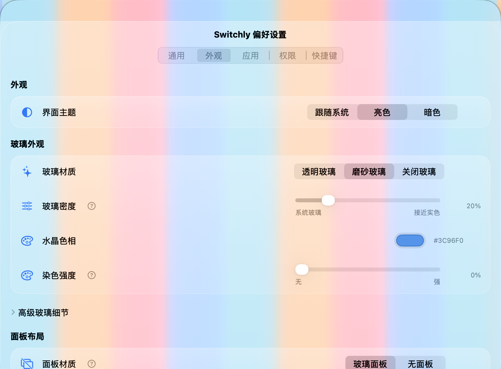
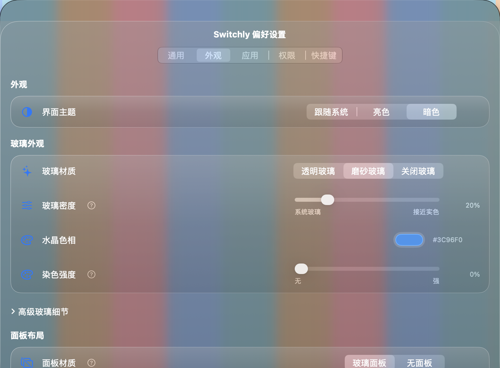
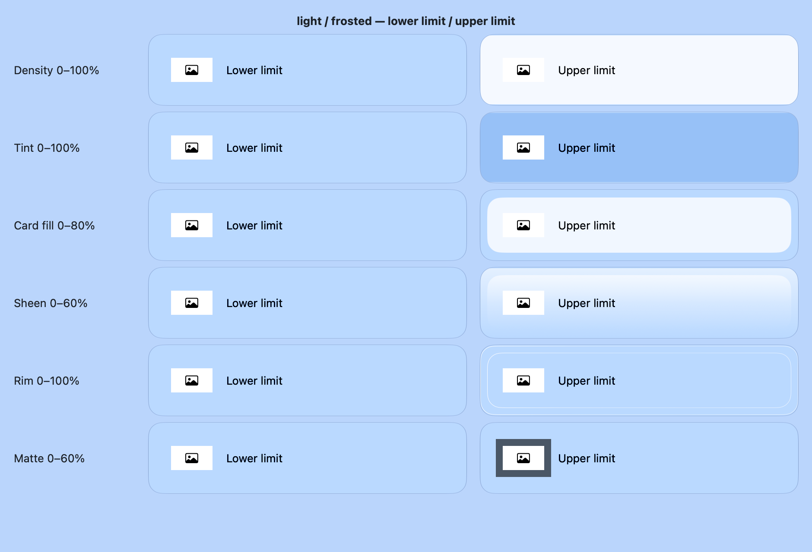
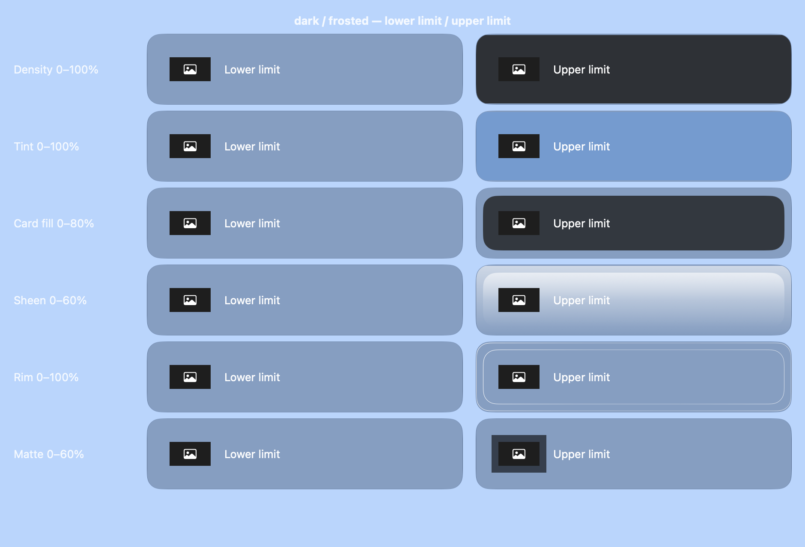
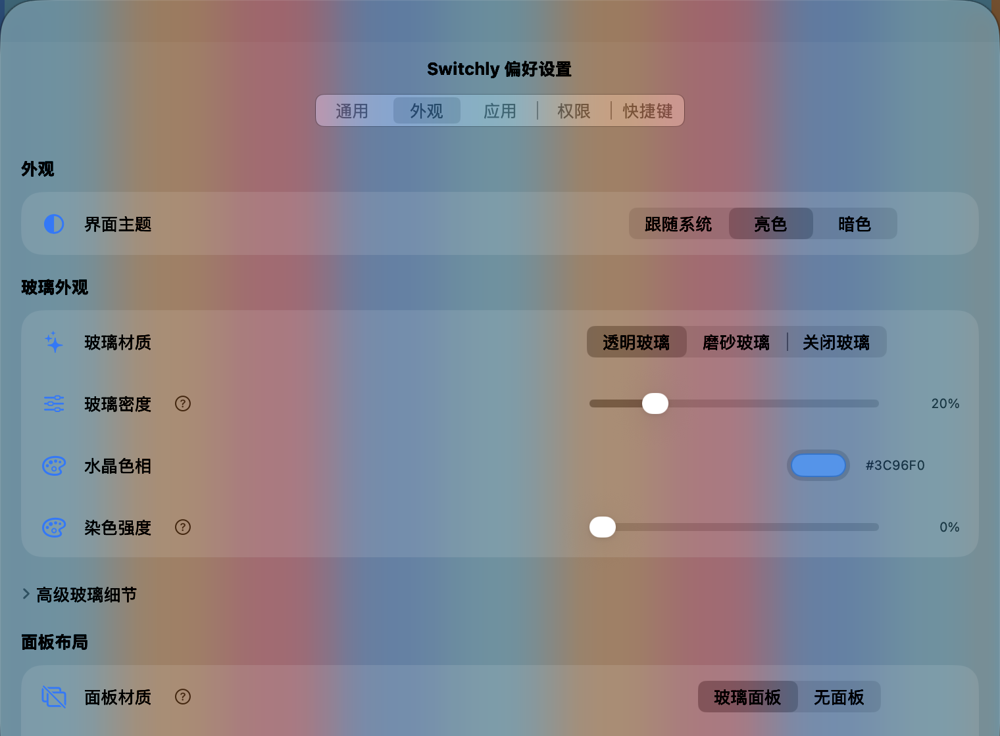
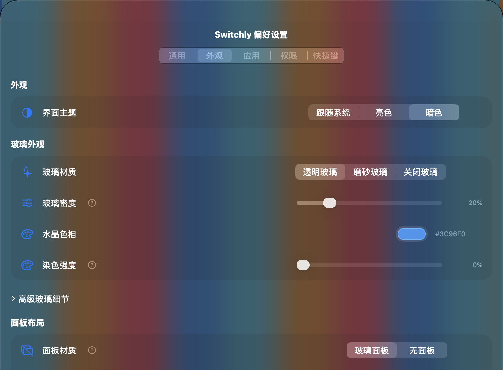
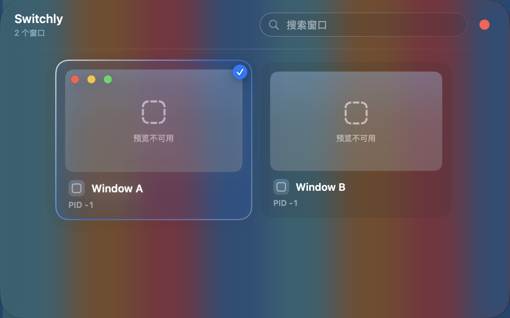
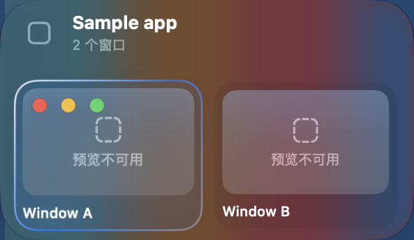

# 玻璃与外观设置梳理

检查日期：2026-10-21。实现基线：`d16c444`（PR #3）。本文是现状诊断与修订建议，不代表下面的目标模型已经实现，也不构成视觉验收通过记录。

## 实施更新

本方案已在当前 PR 中落实。原始诊断保留如下，当前契约以 [设计系统](../design-system.md) 为准。

- 外观集中到独立标签页；基础为主题、透明 / 磨砂 / 关闭材质、共享密度、染色，高级项包含卡片分隔和衬底。
- macOS 26+ 的透明 / 磨砂路径分别使用公开 `NSGlassEffectView` 的 `.clear` / `.regular`，生产视图放入其 `contentView`；旧系统降级。旧的独立明暗底色只保留解码，不再覆盖文字主题。
- 共享解析消除隐藏密度下限及跨窗口染色公式差异。macOS 26+ 两种模式的密度均控制附加中性阅读层，0 保留系统玻璃；旧系统控制背景材质 alpha。染色与高光独立。
- 旧强度字段保留；共享密度为空时提示旧差异，拖动后才统一。旧值保留不等于保留旧版不直观的渲染公式。
- 次要文字改为主题语义色；原生模式不重复绘制旧柔光。设置分类使用内容区内的原生分段选择器，避免系统将标签栏搬到玻璃外的标题区域。

### 磨砂后续修正

用户反馈磨砂仍有灰黑底，确认其仍走旧 `.popover` 路径。macOS 26+ 改用原生 `.regular`，与透明模式共享内容容器、染色和密度。暗色原生磨砂仍有系统阅读压暗，不承诺完全无色；macOS 12–25 保留旧材质降级。本次又完成了边缘与范围修正，最新测试与截图见下一节。

### 边缘与调节范围后续修正

用户反馈边缘高光像黑线、卡片只显示半圈，且部分滑块从头到尾变化很弱。检查发现共享边缘在浅色主题选用石墨色，并且后面三个渐变节点均为透明；这不是裁切造成的半框。改为四周非零的白色反光，保留左上较亮的层次。浮动面板删除调用方的第二层外框，由材质容器负责一次。系统原生自带边缘与蓝色选中态不属于这个滑块。

| 调节项 | 原来 / 问题 | 当前范围与处理 |
| --- | --- | --- |
| 原生玻璃密度 | 滑块 0–100% 只映射附加底层 0–18%，变化弱 | 仍为 0–100%，映射底层 0–85%；端点标明系统玻璃 / 接近实色。不是模糊半径。 |
| 染色强度 | 0–100% 映射颜色覆盖 0–35% | 保留，端点已截图确认可辨；不会让高光随染色强度一起消失。 |
| 卡片分隔 | 0–30% 中性卡片填充 | 扩大至 0–80%，从无填充到明显的独立卡片；关闭玻璃时隐藏此玻璃专用项。 |
| 顶部柔光 | 0–40%，卡片上还跟随染色颜色 | 0–60%，改为独立白色反光，百分比显示；仅磨砂可调。 |
| 边缘高光 | 0–100%，石墨半框 | 范围保留，改成完整白色反光，百分比显示；仅磨砂可调。 |
| 缩略图衬底 | 0–60%；玻璃关闭后暗乘 0.375，上限只有 22.5% | 保留 0–60%，移除隐藏倍率；新增留边示意。真实图片铺满容器时遮住衬底。 |
| 窗口副本延迟 / Dock 悬停延迟 | 0.1–1.0 / 0.2–1.0 秒，步长 0.1 | 保留；源码核对到消费路径，未发现视觉强度类的隐藏倍率，本轮未重新计时实测。 |
| Dock 卡片宽度 | 80–600 pt，步长 10 | 保留；直接参与缩略图与面板几何计算，面板总宽仍受屏幕边界限制，本轮未重新做真实 Dock 悬停验收。 |

保留存储键、默认值和旧数值，不按扩大后的范围重算已保存的卡片 / 柔光设置。密度响应有意增强，同一个旧密度数值现在会提供更强的阅读底层。白色反光在白色背景上天然较弱；染色与底色接近、缩略图无留边也会降低可见差异，不能承诺任意背景都具有相同对比度。

最新验证：`make build` 与显式开启桌面截图的 `TEST_RUNNER_SWITCHLY_CAPTURE_GLASS=1 make test-unit` 通过，260 项测试、0 失败。已查看亮暗磨砂与透明模式的端点样例，以及设置页和 Dock 的代表性合成截图。旧系统真机、真实 Dock 悬停和完整键鼠流程未重新验证。

以下为测试宿主在屏幕上运行共享生产材质、卡片和缩略图衬底绘制后的端点对照；每行固定其他参数，左侧下限、右侧上限，蓝底是合成背景。它是材质验收样例，不是设置页或真实窗口缩略图截图。

### 验证证据

2026-10-21，macOS 27.0.1 / Apple Silicon，Debug 测试宿主：`make build` 通过；`TEST_RUNNER_SWITCHLY_CAPTURE_GLASS=1 make test-unit` 258 项测试、0 失败（包括显式启用的桌面合成检查）。生成工程差异只包含新增原生容器与测试文件，`git diff --check` 通过。

已查看同一合成背景上的浅 / 深主题 × 透明 / 磨砂 / 关闭设置页，以及 Preview / Dock 的代表性实际合成截图。以下截图来自测试宿主中运行的生产视图，不是 HTML 原型或离屏绘制；彩条为自建背景，示例标题与不存在的窗口 ID 用于避免暴露工作内容，因此缩略图显示降级占位。它们不能证明真实截图链路、Dock 悬停、跨屏定位或所有壁纸下的对比度均已通过。

| 浅色外观 | 深色外观 |
| --- | --- |
|  |  |

视觉检查使用屏幕区域合成截图；单独窗口截图会失去背后的采样背景。可选择性复现：`TEST_RUNNER_SWITCHLY_CAPTURE_GLASS=1 make test-unit`。普通 `make test-unit` 会跳过桌面截图项，避免 CI 弹窗和截图权限依赖。

仍未覆盖：macOS 12–25 真机降级、真实 Dock 悬停与多屏、全套键鼠操作和所有壁纸下的对比度测量。PR 保持草稿，不自动合并。

## 结论

上一版通过独立切换 NSVisualEffectView 的明暗外观，无法从根本上消除磨砂灰膜，且引入了「深色文字主题 + 明亮玻璃底层」等冲突组合。应先统一材质与文字主题契约，再调整设置结构；不继续增加同用途的颜色控制。

截图显示浅灰背景、不同深度的卡片底色、黑色标题与白色 PID 混用。透明面板采样的背景不同，最终像素本来就可能不同；一致性要求应是相同设置使用相同材质、染色与层次规则，而不是让不同位置的玻璃呈现同一 RGB。

## 当前实例与持久化证据

检查时运行实例来自 `build/Switchly.app`，不是 `DerivedData/Build/Products/Debug/Switchly.app`。前者的资源中已包含 PR #3 的玻璃底色文案；不能仅凭路径认定它没有包含上一版功能。未重启或更改该运行实例，也未修改用户保存的设置。

仅核对外观相关字段：

| 字段 | 保存值 | 实际含义 |
| --- | --- | --- |
| `theme` | `dark` | 应用请求深色 AppKit 外观。 |
| `crystalMaterial.baseTone` | `light` | 系统模糊背景单独强制明亮，与主题形成混合。 |
| `enableBackgroundBlur` | `true` | 浮动面板启用玻璃。普通窗口不受此开关控制。 |
| `backgroundBlurOpacity` | 0.25 | 浮动背景实际 alpha 经映射为 0.475。 |
| `preferencesGlassOpacity` | 0.75 | 普通窗口背景实际 alpha 经映射为 0.825。 |
| `tintColor` / `panelTintCap` | 白色 / 1 | 浮动面板白色叠层为 0.07，设置窗口为 0.165，工作区管理和统计为 0.08。 |
| `topSheenOpacity` / `rimTopOpacity` | 0 / 0 | 用户已经关闭顶部柔光和镜面边；仍有灰膜不能归因于这两项未关闭。 |
| `thumbnailBackdrop.opacity` | 0.6 | 缩略图留白的衬底另有 60% 的浅色填充；与面板透明度独立。 |

## 实现问题

### P1：底层是磨砂材质，不是透明水晶实现

`GlassSurface` 固定创建 `.popover` 的 `NSVisualEffectView`，然后叠染色、柔光、描边。`GlassBackground.alphaValue` 同时衰减整个系统材质和其模糊效果，没有独立控制「透光」与「模糊半径」。把白色叠得更多只能使表面更白，不能把磨砂变成透明折射。

当前代码注释只排除了 SwiftUI `View.glassEffect`，不能据此断言 SDK 不支持原生玻璃。本机 macOS SDK 的 `AppKit.framework/Headers/NSGlassEffectView.h` 明确定义了 macOS 26+ 的公开 `NSGlassEffectView`，包含 `.regular` / `.clear`、`tintColor`、`cornerRadius`、`contentView`。内容须按该 API 的 `contentView` 契约放入，不能简单把一个空玻璃视图当背景就宣称完成原生适配。

**建议：**先做同背景、同尺寸的 `.clear` / `.regular` / 旧材质原生样张，验证文字、点击、圆角、多屏、合成与性能，再决定生产接入。macOS 12–25 继续系统材质降级，不能承诺与新系统完全相同的折射。不得使用私有滤镜模拟系统玻璃。

### P1：同名强度跨表面不是同一含义

`GlassAppearance.panel` 与 `.window` 使用不同染色与柔光公式。普通窗口中还存在染色强度影响柔光、浮动窗口却不影响柔光的差异。统计没有中段柔光，其他普通窗口存在固定 0.04；浮动面板存在固定 0.05。

`GlassWash.opacity` 把任意正数映射到 30% 以上，零到最小非零值有跳变。「25%」实际 47.5%，不符合用户对强度读数的理解。

**建议：**面板与普通窗口共享同一材质参数解析；若确需不同密度，应作为明确的表面层级令牌，而不是隐藏在多个公式中。滑块使用连续、可解释的映射，零必须关闭对应层。染色强度只改变染色，不再暗中控制柔光。

### P1：主题与文字颜色契约冲突

`ThemeApplier` 确实设置了 `NSApp`、已有窗口和根内容视图的 appearance，因此不能说主题完全没有生效。但它只改变语义颜色及系统控件，不改变背后的桌面或其他应用；大量半透明区域因此不会随主题变成整块黑白背景。独立 `baseTone` 又允许材质与文字主题相反，视觉差异进一步混乱。

`Color.crystalSecondary(on:)` 是确定的实现缺陷：强制以 `.darkAqua` 解析表面、将传入表面强制改为不透明，计算出的 `flattened` 没有使用。它不是截图像素采样器，也没有测量真实壁纸亮度。历史注释中的固定对比度结论不能证明当前自定义颜色可读。截图中的白色 PID 与黑色标题混用与此路径吻合。

SwiftUI 根视图目前未显式消费已有的 `AppTheme.colorScheme`。需在真实运行场景核对 AppKit 与 SwiftUI 的主题同步，不能只凭缺少 modifier 就断言这是唯一根因。

**建议：**主题统一控制文字、控件、卡片、中性表面与材质外观；移除新加的独立明暗底色 UI，保留读取兼容。修正次要文字的颜色解析；若没有真实背景亮度采样，不再声称能自动推导壁纸对比度。根视图显式关联主题并测试跟随系统和新开窗口。

### P2：多个局部底色绕开面板强度

Preview 的区域分隔使用固定 2% 柔光；Dock 使用另一套语义底色并按系统版本分支。三类缩略图卡片的底色公式重复，零面板强度时仍至少 6%；设置分组固定叠 10% 语义底色。顶部柔光在浅色中使用石墨色，进一步形成灰色薄膜。

缩略图自身的「衬底」又独立于卡片与面板。用户看到的灰色可能属于四层之一：系统模糊、全局染色、卡片底色、缩略图留白。现有设置没有清晰表达这四层关系。

**建议：**共享卡片与区域层次令牌，取消不必要的整面灰色渐变，避免零值后残留。缩略图衬底保留独立语义，但移入高级设置；不得通过移除所有卡片区分来牺牲焦点和文字可读性。

### P2：测试目前固化的是旧公式

`GlassAppearanceTests.testExistingSurfaceCoefficientsArePreserved` 验证了各表面不同的旧系数；通过表示「保持旧行为」，不表示材质一致或视觉正确。上一版 253 项测试通过不能作为本次截图问题已解决的证据。

修订测试应覆盖统一解析、零值、主题传播、设置迁移与运行态更新，并增加实际桌面证据。离屏渲染只能检查部分布局和颜色，不能替代玻璃合成验收。

## 建议的设置结构

外观设置集中在一个区块，基础项按使用顺序排列。以下为待实现目标，不增加网页式主题预设系统。

| 层级 | 控件 | 唯一职责 | 当前项处理 |
| --- | --- | --- | --- |
| 基础 | 界面主题：跟随系统 / 浅色 / 深色 | 统一文字、控件、中性底色及材质外观 | 保留 Theme，修正传播和文字颜色；撤回新加的独立明暗底色 UI。 |
| 基础 | 玻璃材质：透明 / 磨砂 / 关闭 | 决定原生透明或磨砂路径；关闭使用可读实色背景 | 统一当前 blur 开关和材质概念。旧系统明确降级。 |
| 基础 | 玻璃强度 | 控制玻璃存在感与透射程度，提供百分比且零值语义一致 | 合并普通窗口与浮动面板的基础入口；迁移旧值时明确规则，不悄悄覆盖差异。 |
| 基础 | 染色颜色 + 染色强度 | 只改变附加色相和颜色覆盖度；0 为不染色 | 复用现有颜色，不另建颜色设置；去除对柔光的耦合。 |
| 高级 | 卡片分隔强度 | 控制缩略图外侧的卡片底色，兼顾可读性 | 收敛重复公式；是否需独立持久化，在原生样张后决定。 |
| 高级 | 边缘高光 | 控制轮廓反光；不以整面灰色模拟柔光 | 收敛 Top sheen / Rim highlight；原生玻璃自带光泽时避免重复绘制。 |
| 高级 | 缩略图衬底色 / 强度 | 仅控制图片未覆盖的留白 | 保留原设置与数据，改进位置和帮助文案。 |
| 布局 | 无面板、网格 / 舞台等 | 控制结构，而非材质或主题 | 「无面板」保留浮动面板专属语义，移到布局；不能让设置窗口也无背景。 |

普通窗口如经实际可读性验证需要更强底色，优先使用同一材质的明确阅读密度规则；只有用户确有分别调节需求时才展开高级覆盖项，避免默认出现两套同名透明度。

玻璃关闭、透明强度为零、浮动无面板是三个不同状态，必须明确区分：关闭是实色可读背景，零是对应效果层透明，无面板是取消浮动面板结构。

## 修订顺序与验收门槛

1. 保留本诊断及原始设置，先用原生样张验证公开 AppKit glass API 的真实效果和内容容器契约；没有实际截图不选择默认材质。
2. 修正主题传播和次要文字颜色，统一共享材质及卡片层次；不为每张卡片新增模糊视图。
3. 收敛基础设置与高级设置，同步双语说明，设计旧数据迁移；不要以重置设置解决问题。
4. 验证当前已打开的 Preview、Dock、设置、Workspace 和新开窗口即时生效，重启后值与效果保持。
5. 同一背景下检查浅色 / 深色 / 跟随系统，透明 / 磨砂 / 关闭，染色零值和中高值；检查长标题、PID、搜索框和焦点。不同背景下检查透色差异是否合理，不能要求不同采样位置像素相同。
6. 执行 `make build`、`make test-unit`、`git diff --check`；查看实际运行截图并记录系统、产物路径及限制。

以上问题与建议记录的是 d16c444 的历史诊断。后续实施及验证结果见文首「实施更新」；PR #3 仍保持草稿且不得自动合并。
