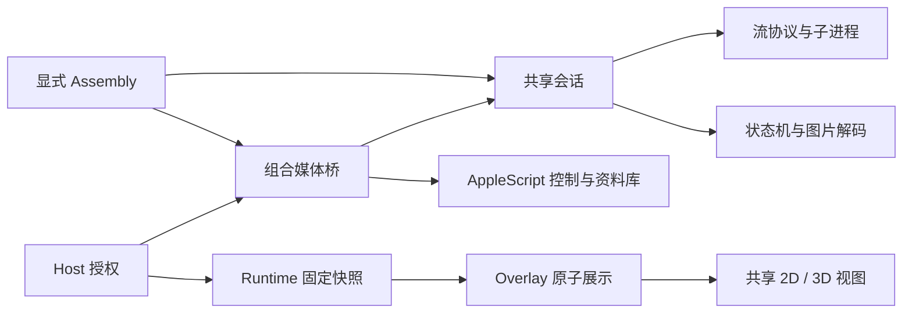

# MR-T05／T06 本机验证与模块化审查

> 2026-11-10。结论：完成当前机器可执行的宿主注入式验收、候选包准备和架构整改；完整跨系统／发行门禁仍未通过。默认桥仍为 AppleScript，不提交、不推送，不执行发行证书签名、公证或发布。前序见 [T03／T04](music-mediaremote-t03-t04-2026-11-10.md)，契约见[接入设计](../../plugins/mediaremote/music-mediaremote-integration-plan.md)。

## MR-D08：模块职责与系统装配分开

审查结论是「总体保持模块化，修正发现的实际耦合」，不宣称全库完全解耦，也不以新增大量协议替代明确所有权。

| 模块 | 单一职责 | 边界 |
| --- | --- | --- |
| `MediaRemoteAssembly` | 装配实际 Music 进程身份、AppleScript、子进程与会话 | 必须显式传入依赖位置；默认 Host 不调用，构造不启动采集 |
| `MediaRemoteChildProcess`／`MediaRemoteStream` | 固定进程、管道、协议解码、连接与超时 | 不认识插件、View 或播放控制策略；进程可注入夹具 |
| `MediaRemoteState` | 来源／歌曲身份、full／diff、进度与候选字节 | 纯状态规则；不执行脚本、不解码图片、不驱动 UI |
| `MediaRemoteSession` | 共享兴趣、系统生命周期、状态归并与单个解码工作 | 状态在专用串行队列；展示端只读缓存，不反向依赖 ViewModel |
| `CompositeMediaBridge` | 配对、来源选择、整组回退及定向命令转发 | 依赖注入的脚本／会话／身份来源；系统对象构造已移到 Assembly |
| `MediaArtworkDecoder` | 图片格式、尺寸、实际位图与预算检查 | 纯后台解码，不联网、不写磁盘；只复用缩略图的纯尺寸函数，不启动缩略图服务 |
| `PluginHost`／`PluginRuntime` | 授权、运行时依赖与按调用固定的 JS 快照 | 不解析 MediaRemote 原始 JSON；不把图片／内部 token／source 交给 JS |
| `DockPluginOverlayModel`／共享视图 | 批次有效性、整组展示和交互路由 | 不创建 Adapter，不选择系统来源，不做图片解析；2D／3D 使用同一展示状态 |



公开插件 API、manifest 和插件锁没有因来源新增而变更。没有新增按插件 ID 的宿主业务分支，没有引入运行时网络、全局播放器模式或新的单例。叠层原有的 next／previous action ID 兼容处理继续保留；本次不为审查重写其他历史实现。

## MR-D09：修复共享生命周期与主线程等待

发现并修复两项实际问题：

1. 旧 Session 在 NSLock 内调用状态归并、Base64 转换与图片摘要；主线程有效性检查可能等待大图计算。现改为 `updates` 串行队列拥有状态，短锁只替换／复制缓存引用，旧缓存释放与通知也在锁外。UI 的 `isCurrent`／`isArtworkCurrent` 不查进程、不执行脚本、不等待状态归并队列。进度投影保留实际播放速率，不新增歌曲代际。
2. 多个 Overlay 共用同一 Runtime 时，过去会覆盖 `onInvalidate`，并在其中一个隐藏时挂起其他消费者的 VM。现由 Host 的 `PluginRuntimeVisibility` 统一引用计数和分发通知：首个消费者 resume，最后一个释放才 suspend；旧句柄在 reset 后不能影响新消费者。

通用释放句柄提取为 `PluginLifetime`，媒体兴趣保留内部类型别名；合并通知提取为 `PluginInvalidator`，运行时生命周期不再依赖媒体文件中的实现。通知直接取得监听者快照，再按消费者合并主线程回调，不为每次失效另排一条无界队列任务。新增共享 VM、旧句柄、UI 缓存读取不查询进程，以及倍速进度的回归测试。

本次不是全面重构：Host 原有 Registry／设置读取方式、Runtime 的软超时和同步 JS 无硬隔离等历史边界保持原状；不能据此宣称整个插件系统已实现进程隔离。

## M-I09：真实宿主面板与浏览器抢占

新增 `MediaRemoteLiveIntegrationTests`，仅在显式传入 `TEST_RUNNER_SWITCHLY_MEDIAREMOTE_LIVE_DIRECTORY` 与 `TEST_RUNNER_SWITCHLY_MEDIAREMOTE_LIVE_PLUGINS` 时运行。普通单元测试跳过，不触达真实播放器。可另传 `TEST_RUNNER_SWITCHLY_MEDIAREMOTE_LIVE_ADAPTER` 验证候选 App 包内路径。

该入口使用真实 `PluginHost`、制品中的音乐插件、Runtime、Overlay、`DockPreviewViewModel` 与 `DockPreviewPanel`，只通过构造参数注入候选桥；设置使用独立临时 suite，未更改用户偏好。面板位置由测试指定，不代表默认 DockHoverMonitor 的鼠标悬停入口已切换到新桥。

| 场景 | 实际证据与结果 |
| --- | --- |
| 2D／3D 封面 | 实际查看窗口合成截图。2D 的《玛雅》与 3D 的同歌封面一致；快速切换后的 Black Cloud, Red Fire 与 Drift with the Wind_Blissful Retreat 也与 Music 原生界面核对一致 |
| 浅／深色 | 查看真实面板的 2D 浅色和 3D 深色；前序共享视图夹具另覆盖浅／深色。不是所有外观组合的正式视觉基线接受 |
| 暂停／恢复 | 通过插件动作调用原有 AppleScript，观察暂停状态与进度冻结、恢复后推进；控制目标仍为 Music |
| 喜欢 | 真实切换喜欢并恢复原值；最终 `canLike=true`，没有因 MediaRemote 候选的内部状态而丢失喜欢能力 |
| 快速切歌 | 通过真实插件 action 连续发出三次 next；旧批次撤图，最终新标题／图一致。最终自动验收采样 138 条，其中 102 条来源为 MediaRemote；有图且 token 对应的标题不一致计数为 0 |
| 隐藏／再显示 | 隐藏后的自有 Adapter 数为 0，再显示后为 1；再次建立新连接和封面资格 |
| 睡眠生命周期 | 注入与系统通知相同的 Session 睡眠／唤醒入口，确认重连；**没有让整台机器真实睡眠**，不替代系统睡眠实测 |
| 浏览器抢占 | Chrome 的本地音频虽播放但未成为本机系统来源；改用 Safari 后实际来源为 `com.apple.WebKit.GPU`、标题为本地夹具。Host 使用 AppleScript 的 Music 数据并撤图；Safari 暂停后依然占会话，Host 继续回退；关闭标签后系统来源返回 `com.apple.Music` |
| 返回 Music | 原歌曲两来源歌手大小写不一致，仍按契约回退，没有为通过而放宽匹配。下一首可靠配对后封面恢复。浏览器专场采样 544 条，其中 AppleScript 442 条、MediaRemote 97 条；对应 token 的标题不一致计数为 0 |

上述两轮显式 live 测试均为 `TEST SUCCEEDED`，实际有图采样分别为 90 与 97 条。它们证明当前机器上的注入式链路，不证明所有异步到达瞬间、同元数据不同版本或所有系统版本绝不会错配。

取证中发现 `NSView.cacheDisplay` 不能可靠捕获 SceneKit，产生过空白 3D 图，未按通过处理。后续改用现有 ScreenCaptureKit 窗口合成截图并实际看图。最初两轮人工驱动未在窗口期限内写入 finish，测试按超时失败，日志保留；后续有界自动步骤与浏览器专场显式结束后通过，没有删除超时断言或降低图片要求。

Music 的原歌曲、暂停、约 0.208 秒进度、音量 57 及歌词界面已恢复；浏览器测试标签和本地服务器已关闭，Adapter 已停止。真实切歌产生的播放历史／自动队列变化没有清理。恢复过程中发现 streaming persistent ID 不适合跨播放操作重定位，最终通过 Music 原生历史／上一首恢复，不把它当成权威跨来源 ID。

## MR-D10／M-I10：隔离候选包与兼容证据

增加显式命令：

```sh
make mediaremote-adapter-stage \
  MEDIAREMOTE_APP="DerivedData/Build/Products/Debug/Switchly.app" \
  MEDIAREMOTE_OUTPUT="$TMPDIR/<任务目录>/MediaRemote Candidate.app"
```

它只接受宿主 App，拒绝 Preview／Worker、输入 App 内的输出、既有输出和资源路径符号链接。生成新副本，移除候选副本中的旧资源签名，再将离线依赖放在 `Contents/Resources/MediaRemoteAdapter`；失败只删除本次创建的候选副本，不修改输入。它不签名、不改变默认桥、不加入普通 build 或 release。候选副本必须重新完成正式签名／公证验收后才可能分发。

实际将带空格的候选 App 包内路径注入 live 测试，Perl／framework 成功加载。依赖的 arm64 与 x86_64 均声明 macOS 12.0，依赖链接只含系统框架；arm64 与 Rosetta x86_64 的实际 `get` 都退出 0 并产生合法 JSON。Rosetta 不等于 Intel 真机。

宿主显式 `ARCHS=x86_64 ONLY_ACTIVE_ARCH=NO CODE_SIGNING_ALLOWED=NO` 构建成功，使用既有本地 SourcePackages、固定 resolved 版本并跳过更新；产物是 x86_64，声明 macOS 12.0。尝试给整个 xcodebuild 套禁网 sandbox 时，SwiftPM 的嵌套 sandbox 被系统拒绝，已按失败记录；后续缓存构建不声称经过禁网沙箱。独立依赖本身仍沿用 T01 已完成的离线构建。

`codesign --verify --deep --strict` 对候选副本实际返回 `invalid resource directory`，这是未完成资源签名的候选状态，**不能作为发行包使用**。没有查询私有签名配置、证书凭据或执行公证。

## 最终检查与未完成门禁

最终实际验证结果：

| 检查 | 结果 |
| --- | --- |
| `make generate`／`make build` | 成功，`Build complete!`；没有本轮新增 Swift 编译警告 |
| `make test-unit` | `Executed 798 tests, with 9 tests skipped and 0 failures`，`TEST SUCCEEDED`；新增的 live 测试默认跳过，其余 8 个跳过沿用既有项目 |
| 显式真实媒体验收 | 两轮通过：138 条／544 条采样；已查看真实面板 2D／3D 合成截图与 Music 原生界面 |
| Intel 宿主编译 | `BUILD SUCCEEDED`，x86_64，最低系统声明 12.0；仅编译证据 |
| 候选包内 Adapter | arm64 与 Rosetta x86_64 的实际读取退出 0，均解析出 JSON；包内空格路径可用 |
| `make mediaremote-adapter-test` | 9 个测试，`OK`，含候选覆盖／错误目标／失败清理保护 |
| Preview Worker 独立测试 | `PluginPreviewWorker tests passed`，仍不启动真实 Adapter |
| 默认来源／普通 App | `MusicAppleScriptBridge()`；普通 Debug App 不含 MediaRemoteAdapter 制品 |
| 范围／链接／卫生 | 范围外既有 tracked diff 保持一致，3 个相关台账共 12 个相对链接有效，`git diff --check` 无输出；本轮 pycache、临时脚本与大体积产物已清理 |

Xcode 仍有既有 CoreSimulator 版本提示，但 macOS 构建和测试成功；未修改系统环境。日志、source 诊断、live JSONL 与已查看的合成截图仅保留于系统临时目录 `switchly-mr-t05-t06`，不把个人原始播放载荷或截图加入仓库；候选／Intel 构建中间产物在核验后清理。

`make plugin-preview-contract-check` 的公开 API 哈希仍匹配，但 renderer revision 因原有工作区渲染改动不一致而失败。本轮没有改该 revision 脚本覆盖的视图源码，也未更新常量或接受新基线绕过门禁。

| 门禁／任务 | 最终边界 |
| --- | --- |
| MR-T05 | 当前机器的注入式真实面板与浏览器场景已验证；默认悬停入口、完整主题矩阵、真实系统睡眠、真实资料库／自动化拒绝全链路及渲染基线仍待验收 |
| MR-T06 | 候选打包、双架构 Adapter 读取及 Intel 宿主编译已完成；macOS 12／Intel 真机、正式资源签名、Hardened Runtime 发行包与公证未完成 |
| MR-G01／G02 | 组件回归与上述本机场景有证据；同元数据版本和真实系统生命周期的全矩阵未覆盖，不写成无条件通过 |
| MR-G03／G04 | 部分场景通过，整体门禁继续未通过；默认来源继续 AppleScript |

交付按项目 AGENTS.md §8 与通用清单核对：保留任务开始时的其他脏改动，不改插件外仓／公开 API／锁文件，不新增运行时联网，不提交或推送。已明确列出未验项，未通过项不以文档重定义为通过。
