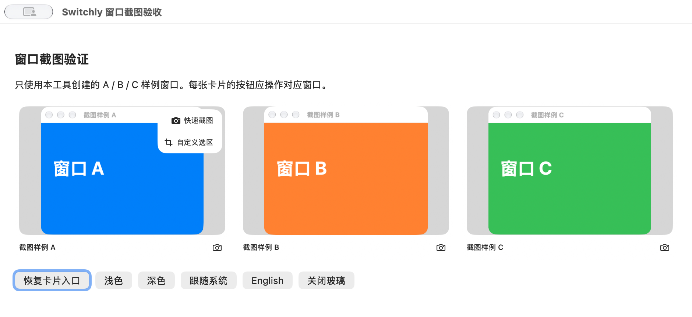
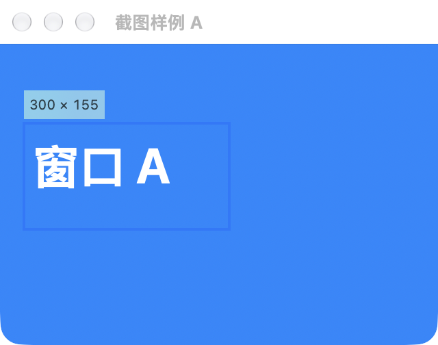
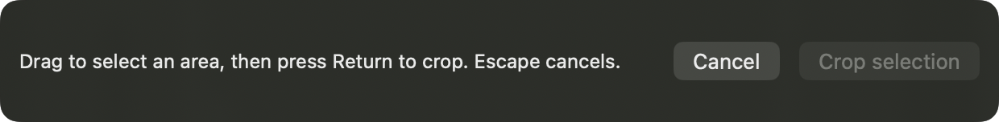
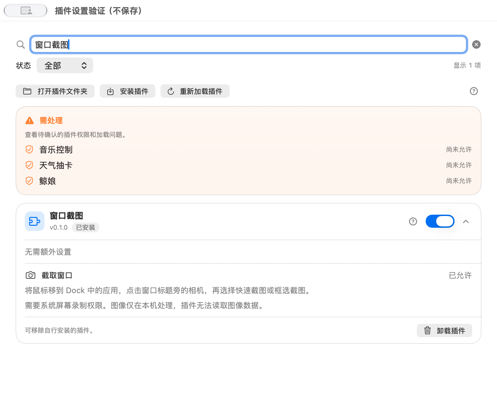
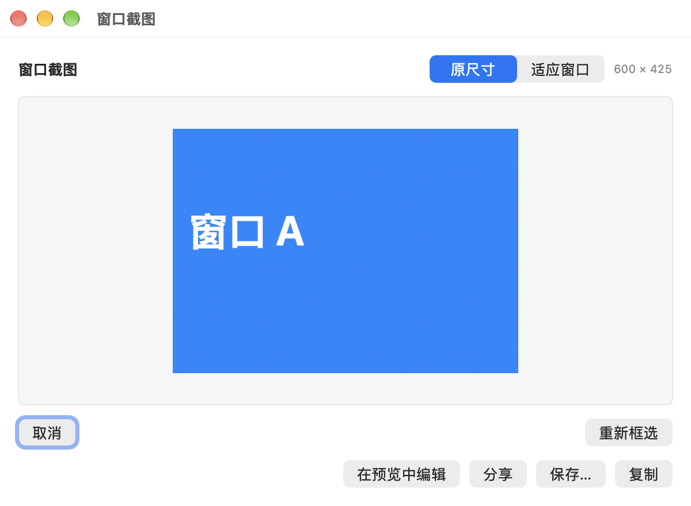
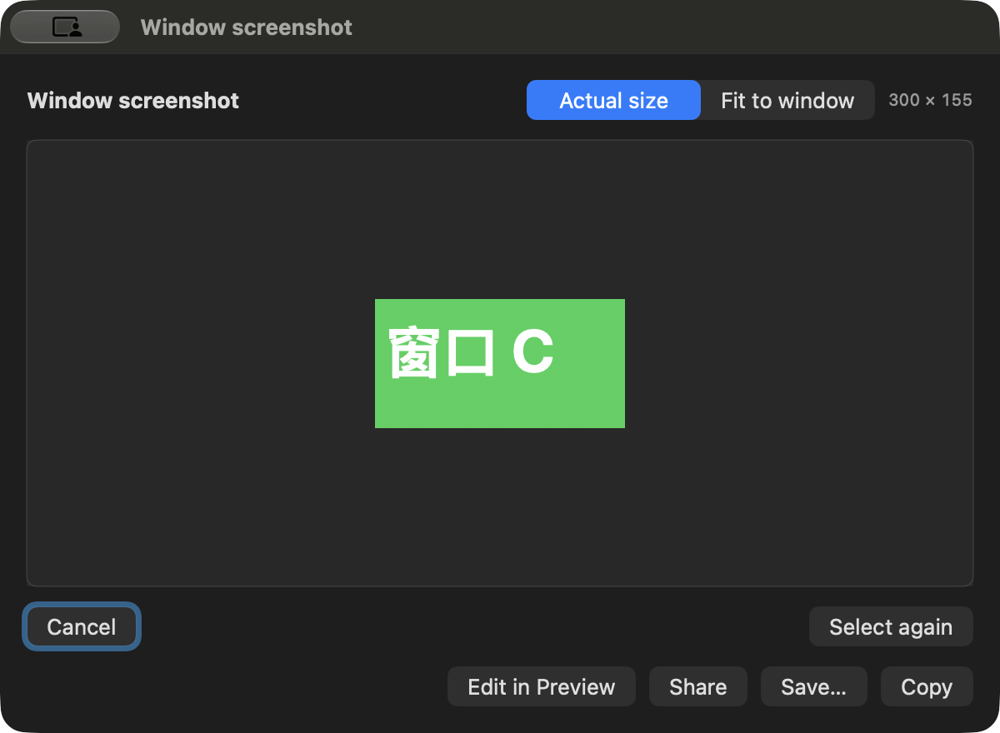

# 窗口截图使用反馈回归（2026-11-12）

本次处理设置展开空白、部分应用不显示相机、框选显示尺寸及裁剪后无法重新框选四项反馈。合同追加 WC-D14～D17；原实现和本次修正的边界不变：插件只提交动作，像素由宿主本地处理。

## 问题与修正

| 编号 | 问题与依据 | 最终行为 |
| --- | --- | --- |
| CF01 | 截图 manifest 没有 `settings`；内置插件既无设置项也无卸载行，展开区没有内容。真实原版设置窗口复现。 | 无选项时显示“无需额外设置”；声明 `window.capture` 的插件额外显示授权状态、Dock 相机入口用法与屏幕录制要求，不虚设持久化选项。 |
| CF02 | 当前 ChatGPT 进程的 `NSRunningApplication.launchDate` 为 nil，`pluginContext(for:)` 直接返回 nil。 | 通过统一的 `WindowCaptureProcessIdentity` 读取内核进程启动时间，入口和抓取前后均使用同一来源，继续拒绝失效 PID／windowID，不能以当前日期替代身份。 |
| CF03 | 旧界面按固定截图窗口的可用区域自动缩放，较小窗口也会放大。 | 用户进一步确认位置也不一致。框选改为在原窗口全局坐标和点尺寸上显示冻结原图，操作栏独立显示，不挤压图像。结果窗口保留原尺寸／适应窗口和双向滚动，缩放或像素密度变化时清除旧选区。 |
| CF04 | `crop` 替换了唯一图像，没有返回裁剪前图像的动作。 | 保存同次冻结基图，裁剪后可“重新框选”回到相同原位覆盖层，能选取首次裁剪外的像素。外部编辑重读后以修改后的图片作为新基图；编辑未结束、关闭、导出或撤权时禁止重置。 |

用户已确认原图内容正确，问题涉及显示大小和位置；同时确认 ChatGPT 已显示相机，并要求按钮整体右对齐。相机与展开菜单已按自身内容宽度布局，靠各卡片右侧对齐，原生截图确认。

## 自动验证

在 macOS 27.2／arm64 上执行：

```sh
make build SWITCHLY_PLUGIN_SOURCE=../switchly-plugins-capture-wt/dist-v2/Plugins
make test-unit SWITCHLY_PLUGIN_SOURCE=../switchly-plugins-capture-wt/dist-v2/Plugins
plutil -lint Resources/en.lproj/Localizable.strings Resources/zh-Hans.lproj/Localizable.strings
git diff --check
```

隔离构建与原工作区最终构建均成功。完整单测结果为 `Executed 871 tests, with 9 tests skipped and 0 failures`。双语 strings 校验通过。CLI `npm test` 为 `70/70`；`make plugin-preview-contract-check` 通过契约哈希、渲染器 revision 和 33 个共享源码守卫；`make plugin-preview-build` 的 App 与 Worker 均构建成功。新增 Capture 尺寸令牌触发渲染源码 revision 变化，已按原检查同步为 `sha256:e019de6411d0b1f77f6a6f7cb760fb49de740415cc7709d5c2d5015e6d1eb874`；没有覆盖外仓视觉基线。Xcode 输出当前机器既有的 CoreSimulator 版本不匹配提示，macOS 构建与单测成功，没有关闭警告门禁。

新增／扩展的回归覆盖：内核启动时间稳定性与无效 PID、Dock 窗口 owner 绑定、原尺寸 Retina 像素换算、大图滚动画布坐标、重复裁剪恢复冻结原图，以及编辑未结束禁止重新框选、原位面板尺寸／位置与再次框选恢复、首次鼠标拖动、旧会话排队回调不能改变新会话。外部编辑重读后保留标注基图的既有会话测试同步扩展。

对本机运行中的 ChatGPT 使用正式身份函数直接验证，仅打印能力布尔值，不读取窗口内容：

```text
app=ChatGPT launchDateAvailable=false captureIdentityAvailable=true stable=true
```

## 原生界面回归

使用 `SwitchlyCaptureProbe` 的真实生产卡片、Runtime、窗口截图服务和截图界面，仅创建并操作工具自己的 A/B/C 窗口，不安装用户插件、不改用户系统权限。

- A 原图 `640×504`：原位覆盖层的 frame 为 `{{80, 180}, {320, 252}}`，与样例窗口 frame 完全相同，日志 `sourceFrameMatched=true`。首次拖动即产生 `300×155` 选区，回车进入结果窗口；“重新框选”恢复原位完整图，再选出更大的 `600×425`。结果窗口缩到 `600×440` 点后所有操作可见。
- C 在深色英文环境原位框选，首次拖动、回车裁剪得到 `300×155`；最小结果窗口各按钮完整可见。原位选区按 Esc 取消已实际验证。独立操作栏的英文指引、取消和裁剪按钮已另行截图并查看。
- 早期 WC-D16 验证过原尺寸大图双向滚动、滚动坐标裁剪与适应窗口；用户补充位置要求后，region 改为 WC-D17 原位覆盖。滚动／缩放保留在结果窗口，不以早期居中选区的截图作为最终原位证据。
- 看过浅色中文、深色英文、跟随系统和玻璃关闭状态。英文最小窗口的模式切换、重新框选和输出按钮完整可见。
- 设置验证窗口展开后显示无需额外设置、已允许、相机用法和本地处理说明；正式主 App 的内置卡片也实际打开并看图确认。
- 本轮没有选择分享服务、没有发送任何图片，也没有改动系统授权。

下面均为本工具的合成窗口证据，已实际查看。设置图使用测试目录包，因此显示“已安装”，并有测试夹具的其他待授权项；没有安装到用户目录。













## 工作区、运行范围与交付自检

先在隔离工作区实现和验证，再通过 `git apply --check` 将本次补丁应用到原工作区。应用前后比较 SHA-256，原有 `AGENTS.md`、`CONTRIBUTING.md`、`docs/engineering/RELEASING.md`、`docs/plugins/plugin-externalization-progress.md` 四个已修改文件的内容完全一致，没有覆盖其修改。

按项目 `AGENTS.md` 第 8 节及通用交付清单核对：本次无外仓插件 JS 或锁文件改动，无新增依赖，无持久化设置或隐私权限扩大；复用现有截图与文件服务、双语本地化和设计令牌。正式图片证据保留在本目录，原始日志和临时构建放系统临时任务目录，交付前清理。

原路径修复版已启动，实际进程路径为 `Switchly/DerivedData/Build/Products/Debug/Switchly.app/Contents/MacOS/Switchly`；既有系统权限被识别，真实 Obsidian Dock 预览已观察到相机按钮。隔离路径副本没有相同系统授权，已退出；没有为验证授予新权限。

系统 Dock 的 CUA 读取返回 `timeoutReached` 后，请用户悬停核对。用户明确回复“chatgpt 已有相机按钮”，此项为用户手动确认；按钮右对齐和原位框选由后续 Probe 原生证据确认。跨屏混合缩放、全屏／其他 Space、macOS 12／Intel 仍未实测，不以单测或 Probe 代替。未进行发行、签名迁移或公证。
