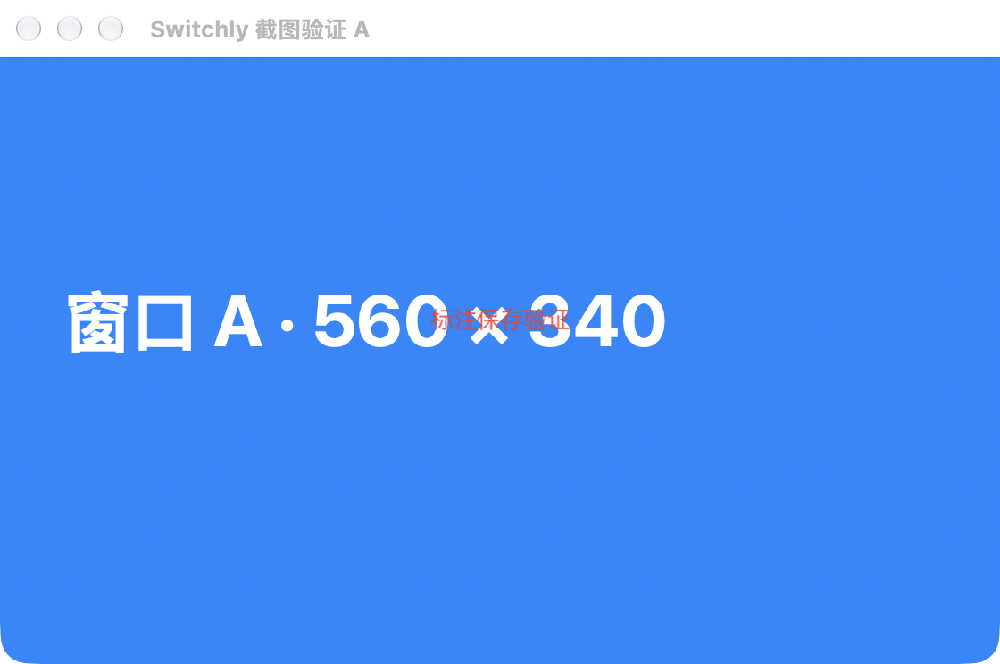
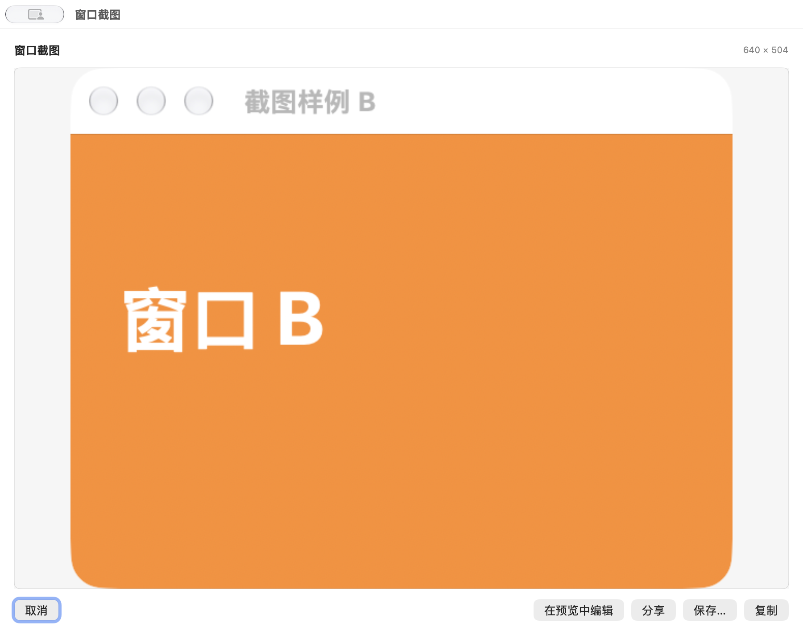
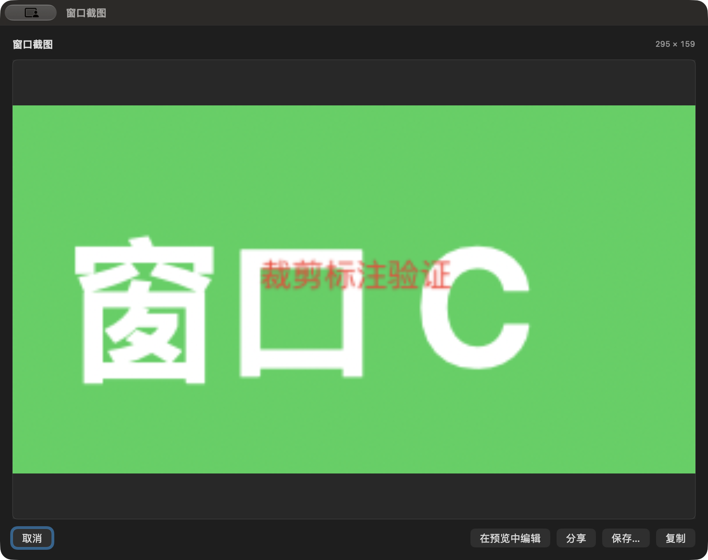
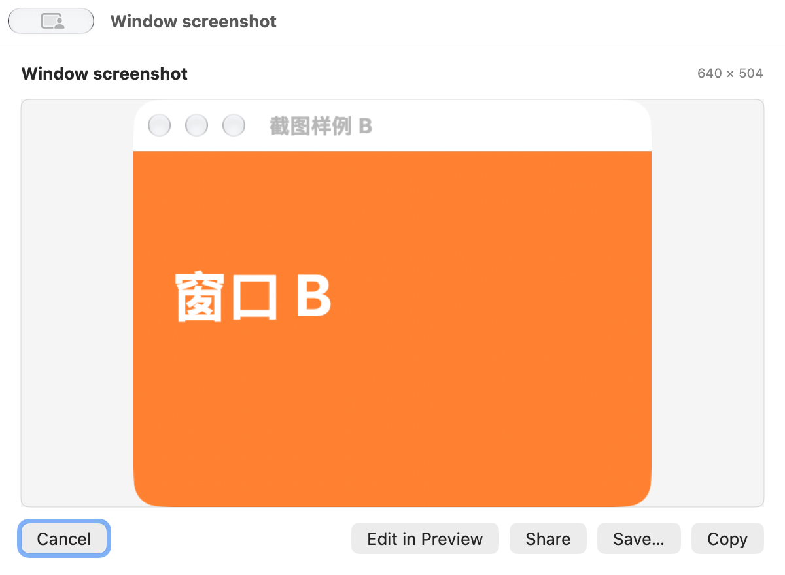

# 窗口截图可行性验证（2026-11-11）

## 范围与环境

隔离分支 `feat/window-capture`，以宿主 main 已提交版本为基线，导入 docs/window-capture-plan 的方案。原工作区与外仓未提交修改保留。临时探针仅显示合成 A/B/C 窗口；未截图工作文档。

为遵循当前任务指定的 schemaVersion 2 锁合同，隔离分支复用原工作区已有的 prepare-plugins.py、update-plugin-lock.py 及 test_plugin_lock.py 变更；没有另造锁算法，也没有写回原工作区。初次验收时外仓尚未获提交授权，候选锁 sourceRevision 为空。随后用户明确授权提交与 PR，现已锁定外仓提交；详情见 V10。

## V01 原始窗口截图：通过当前机器自有窗口验证

以与宿主一致的 macOS 12 部署目标编译 AppKit 探针；直接使用宿主现有的 CG 抓取参数（optionIncludingWindow、bestResolution、boundsIgnoreFraming）。实测：

```text
screenPermission=false scale=2.0
CG window=0 pixels=1120x744 frame=(560.0, 372.0)
CG window=1 pixels=840x584 frame=(420.0, 292.0)
```

图片已实际打开查看，A/B 内容分别对应目标窗口。尺寸包含系统标题栏，不能只用 contentView 的 560×340 作为完整窗口尺寸。自有窗口可读不代表跨应用已获屏幕录制授权；其他进程、混合缩放、多屏、macOS 12/Intel 仍需独立实测。

## V02 系统编辑：预览显式交接通过，Quick Look 自动标注未通过

实际打开 QLPreviewPanel：当前工具栏只有分享和“用预览打开”，没有 Markup 入口；公开 delegate 不提供编辑文件提交回调。此路线不作为正式标注器。

实际打开 Apple「预览」，显示 Markup 工具栏，添加“标注保存验证”，保存、关闭，再打开后仍能看到该文字。合成图片 SHA-256：

```text
编辑前 b3030fcec84da5c8e7200d048f172d1f3625790e2dfed0b281d6fdcaa9f86914
编辑后 59153c27fdf03968326758f3c9c6abf02506191aa7fc09bd667e5e22eaddfd5d
Preview open callback success=true error=false; editor still owns open document
```

打开成功回调发生时图片仍在外部编辑器中，不能自动推断完成。采用宿主显式“读取已保存修改”确认；同一文件重新解码后才能输出。对应 WC-D11 / WC-D12。

已实际打开查看的系统编辑后合成图片（属于测试窗口，不含工作文档）：



## V03 现有超时结构：不具备硬超时保证

初审最小 Swift 探针让 50 ms 超时与不响应取消的约 300 ms 工作竞争，输出 `winner=timeout elapsed_ms=316 configured_timeout_ms=50`。任务组仍等待全部子任务结束。正式共享抓取器已改为一次性回调交付与实际工作名额独立计数；超时、取消、重复回调、物理名额保持和身份复核测试通过。底层物理并发最多 6，实际工作结束才释放名额。

## V04 卡片目标绑定：原差距已实施

原应用叠层只绑定第一扇窗口，bottomBar 也只挂第一卡片。现已新增可选 window 渲染范围，每卡片独立上下文、动作绑定和展开状态。原生 Probe 复用正式卡片、Runtime 和服务，A/B/C 分别操作正确目标；恢复卡片入口和 presentationID 重置已回归。旧 app scope 继续原挂载行为。

## V05 原生流程验收：当前机器自有窗口通过

环境：macOS 27.2、arm64、显示缩放 2x。使用正式 `SwitchlyCaptureProbe` target，显式传入隔离外仓插件；工具仅操作自身样例窗口，不读用户设置、不启动媒体采集、不替换正在使用的主 App。该路径不是跨应用权限或真实 Dock 验收。

| 检查 | 实测结果 |
| --- | --- |
| 多卡片目标 | A/B/C 各自截到对应内容，完整窗口原图 640×504 像素 |
| NSSavePanel 保存 | B 保存为 PNG，实际尺寸 640×504 |
| 冻结选区 | C 拖选并按回车得到 295×159 像素；Esc 取消可用 |
| 外部编辑 | Preview 添加“裁剪标注验证”，保存关闭后宿主显式重读，新标注可见 |
| 私有临时文件 | 编辑会话目录 0700、PNG 0600；普通截图和裁剪不落盘 |
| 复制 | 编辑后 PNG 295×159、24838 bytes；Command-C 可用；流程结束后编辑目录无会话文件 |
| 分享 | 系统选择器可打开、Esc 取消；未选择服务、未发送图片 |
| 外观 | 浅色、深色、跟随系统、英文/中文、玻璃关闭均实际看图 |
| 最小窗口 | 最新版 600×440 pt，保存截图 1200×880 pixels；英文五个操作按钮完整可见 |
| SCK | 自有进程路径实际得到 640×504 原图，查看确认是 A 窗口 |

修复了两处真实 UI 问题：关闭截图后卡片相机不恢复（onChange 读取旧 View 值，改为显式消费新 presentation）；最小窗口按钮裁切（hosting 自动尺寸覆盖窗口最小值，使用 `.minSize` 配合 SwiftUI 最小 frame）。新增最小尺寸和卡片生命周期回归。没有通过增加重试或延长超时掩盖问题。

以下图片均来自本工具合成窗口及真实生产组件，不是实际用户工作窗口或设计示意图。









## V06 独立预览：模拟、后台槽位与原生动作

Preview / Worker 只模拟 `accepted`，不抓屏、不启动编辑器、不生成截图会话文件。每次只运行一个合成上下文；GUI 模拟 Dock 把窗口槽挂第一张卡片，不等于多窗口独立 Runtime 验收。多窗口已由 V04/V05 的原生 Probe 验证。

为新增 window scope 接通 `titleAccessory` / `topTrailing` / `bottomBar`。本轮后台验收发现并修复了旧契约哈希、旧 app 槽位门禁，以及把多个槽的相同插件 ID 合并导致 SwiftUI 复用相机的问题。现在按槽渲染，并共用 scope 对应的槽位集合。

实际执行 `Scripts/plugin-preview.sh run`（脚本内固定 `--background`）验证 ready 和 full 动作场景；均返回 `status: passed`。后台展开图已实际查看，“快速截图 / 自定义选区”文字可见。未回退可见窗口、激活应用或全局键鼠。


进一步复用 `Tests/PluginPreview/BackgroundInputProbe.swift` 独立观察，执行外仓 `native-expanded.json` 和 `native-full.json`：展开场景的真实 `nativeClick` 通过；full 场景连续 5 次、每次两个真实 `nativeClick` 均通过。每次独立观察均为 `onScreenSamples=0`、`activeSamples=0`、`activationEvents=0`、`foregroundChangedSamples=0`。这些结果只验证后台原生动作与模拟提交，不代表真实截图输出。五次观察各有 107、92、97、120、88 个采样；[机器可读结果](window-capture-assets/background-native-summary.json)已保留。

## V07 自动化门禁

以下均在隔离 worktree 实际执行。宿主构建和测试显式传入 `SWITCHLY_PLUGIN_SOURCE=<隔离外仓>/dist-v2/Plugins`，普通构建没有自动更新锁。

| 命令 | 结果 |
| --- | --- |
| `make build SWITCHLY_PLUGIN_SOURCE=…` | exit 0 |
| `make test-unit SWITCHLY_PLUGIN_SOURCE=…` | 826 tests、9 skipped、0 failures，exit 0 |
| 外仓 `npm test` | 49 tests、49 pass、0 fail |
| 外仓 `npm run build` | 旧线 3 包，v2 线 4 包 |
| `npm test --prefix Plugins/cli` | 68 tests、68 pass、0 fail |
| `python3 Tests/test_plugin_lock.py` | 13 tests，OK |
| `Tools/PluginPreview/Worker/Tests/run-tests.sh` | PluginPreviewWorker tests passed |
| `Tools/PluginPreview/Scenario/run-tests.sh` | 默认场景、覆盖、inspect、启动器、调试模型、mock Dock、fixture 路径通过 |
| `Tools/PluginPreview/Artifacts/run-tests.sh` | 产物、哈希与 PNG 测试通过 |
| `make plugin-preview-build` | exit 0 |
| `make plugin-preview-contract-check` | 契约哈希、renderer revision、33 个共享类型守卫通过 |
| `plutil -lint` 两种 Localizable.strings | 两者 OK |
| `./verify.sh` | PASS，0 failed，2 warnings：未提交修改、既有超长文件 |
| 两仓 `git diff --check` | exit 0 |

最终完整单测关键输出：

```text
Test Suite 'All tests' passed.
Executed 826 tests, with 9 tests skipped and 0 failures (0 unexpected)
```

构建有既有 `CoreSimulator is out of date` 环境诊断；macOS 构建退出 0，没有关闭警告检查。Artifact 测试包含故意无效色彩数据的 ImageIO 诊断，测试通过。9 个 skip 属于需要额外桌面或系统集成条件的既有测试，不等同于运行通过；系统行为仍按 V08 独立标记。

契约身份：

```text
sdkContractHash=sha256:c3004c5050145c64484ca9dce7748e3f9f7923d4d7f979ea111979cbd86b2f3b
rendererRevision=sha256:9515d9a1a46eb96deb02a651abbcb06996d86e674ac7189379809fd94a84767e
```

修改共享 Renderer 后旧视觉基线失效，本次没有批量接受或宣称旧插件所有视觉基线通过。原锁的 music/weather/whale 三包内容与基线逐文件一致；新插件只加入 v2 发行线。

## V08 尚未实测与发行条件

- 主 App 真实 Dock 悬停、跨应用屏幕录制与撤权、真实目标最小化/隐藏变化；未对候选主 App 新增系统权限，也未替换原实例。
- 双显示器混合缩放、全屏与其他 Space、macOS 12、Intel、长时间与高压力场景。部署目标可编译不能替代这些实机验收。
- 系统分享的发送结果；本轮只检查选择器和取消，没有向任何接收方发送。
- 原工作区音乐与性能等 WIP 未合入候选分支；合入前需要对齐，不能直接把候选当作最终发行版本。
- 用户后续授权提交与 PR；外仓已提交为 `fbcd7346829fef1f8e5e6c4cff98956ec6da8916`，宿主显式重锁并通过 `make verify-plugin-release`。这只确认来源提交门禁，不代表签名、公证或全部平台发行验收通过；没有合并或发布。
- 当前证据确认技术路径可实现；用户最终视觉与产品体验批准尚未取得。

## V09 交付自检

按项目 AGENTS 第 8 节及全局 delivery-checklist 适用项核对：

- [x] 范围：只在隔离宿主与外仓实现，原工作区修改保留；复用共享 Runtime、抓取、材质和锁实现。
- [x] 界面：双语、主题、键盘与最小窗口已检查；PNG 证据已实际查看。
- [x] 生命周期：主线程界面、取消、退订、迟到回调、物理并发预算和编辑交接已有测试。
- [x] 隐私与兼容：显式授权、无 JS 像素/路径、新旧 manifest 与旧设置行为兼容；无网络与新持久化设置。
- [x] 门禁：真实命令与结果见 V07；未验平台场景见 V08。
- [x] 文档：方案 WC-D08～D13、公开 API、隐私、README、CHANGELOG、预览指南与探针说明已同步。
- [x] 工作区卫生：正式保留合成 PNG 证据，任务临时探针、日志、截图目录在验收后清理；没有读取密钥或私有签名配置。

问题 → 方案 → 后续：原草案缺少按窗口上下文与可靠编辑完成信号 → 独立目标绑定、短提交长会话、冻结选区与显式 Preview 交接已实现并验证 → 剩余平台验收与原 WIP 对齐见 V08。

## V10 提交与 PR 准备（2026-11-11）

用户在完成上述验收后明确要求“提交代码并提 PR 到主干”。两仓使用独立的 `feat/window-capture` 分支，PR 目标均为 `main`。外仓远端主干比初始基线多两个合并提交，但 tree 与初始基线一致；已快进对齐，没有合入额外文件变化。

外仓提交：`fbcd7346829fef1f8e5e6c4cff98956ec6da8916`。提交前重新执行 `npm test`（49/49）、`npm run build`（默认线 3 包、v2 线 4 包）；提交后从干净外仓制品显式重锁，`make prepare-plugins` 校验 4 包，`make verify-plugin-release` 与 13 项锁测试通过。锁内 `sourceRevision` 与外仓提交一致；原三包及新截图插件的内容摘要未变化。

配套外仓 PR：[switchly-plugins #2](https://github.com/leungingit/switchly-plugins/pull/2)。重锁后再次执行宿主 `make build`，退出 0；暂存全部本次文件后 `./verify.sh` 为 0 failed、2 warnings。

原工作区未被写回；原音乐与性能 WIP 对齐、V08 平台验收仍为后续事项。未执行合并、发布、签名或公证。

## V11 CI 失败修复（2026-11-11）

PR #31 首轮 CI 的 `Preview — JSC & protocol (macOS)` 失败，日志显示 `Tests/PluginPreview/run-session-tests.sh` 编译 `PluginRuntime.swift` 时找不到 `WindowCaptureTarget`、`WindowCaptureRequesting` 等类型。本地运行同一脚本复现。原因是该脚本直接列出 Swift 编译输入，新增截图模型后只同步了 Worker harness，漏掉了 Session harness。

修复只在 Session 脚本的真实 Worker 编译输入中加入 `Sources/Models/WindowCapture.swift`，没有关闭检查或改动断言。随后完整运行 CI 中相同的七组脚本：Protocol 8/8、Session 5/5、ProcessSupervisor 7/7，Scenario、Artifact、Reload、Worker 全部通过。CI 的最终结果以 PR 检查记录为准。

## V12 合入后主干 CI 的契约写入竞态（2026-11-11）

PR #31 在运行 43001654552 全部适用检查通过后合入；主干运行 43002775288 的 Node 检查随后出现间歇性哈希不一致。失败哈希 `sha256:4f0fb7cb1a67be7627193a78d6e07de46b4482a93d811fcb2dde3653b3286edb` 恰好等于把 `preview-scenario.schema.json` 替换为空字节后计算的结果。

根因是 Node 测试文件并行执行：打包测试运行 npm prepack，`prepare-contract.mjs` 用 copyFile 重写共享 contract，另一个 Preview 测试可能在目标文件被截断但尚未写完时计算哈希。它不是需要更新契约常量的真实不兼容。

修复为内容相同不重写，变化时先写同目录唯一临时文件，再 rename 原子发布，finally 清理。没有串行化测试、放宽哈希门禁或增加重试。新增并发读写测试在修复前复现空文件/部分内容，修复后要求每个文件只可能是完整旧版或新版；同时覆盖未变化文件。CLI 全套 69 项连续三轮通过。

## V13 并行主干更新的冲突集成（2026-11-11）

等待 PR #33 的 CI 期间，主干合入性能 PR #32（cbce38e）。其中也为相同契约加入了“不重写相同内容”的修复，导致脚本冲突。集成保留该行为和主干新增的内容/mtime 回归测试，同时保留本 PR 的原子替换和并发读写测试。其余性能实现及主干锁文件原样合入；外仓锁更新为 f994a8a 合并提交，包含同时合入的音乐 prepare 优化，未退回旧音乐制品。

集成后实测：外仓 50/50、CLI 70/70、宿主 make build 通过、make test-unit 865 项 / 11 skipped / 0 failures、Session 5/5、锁测试 13/13。主干契约哈希为 `sha256:50397d0bf6be94848d48a883b6b182a40165c5431ade2af862378756dd6dcdfb`，共享源码守卫与 renderer revision 校验通过。
